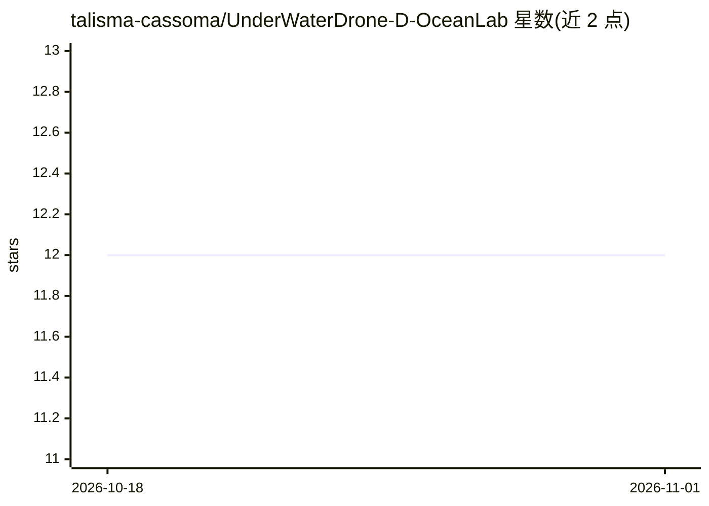

# talisma-cassoma/UnderWaterDrone-D-OceanLab

⭐ 12 · Jupyter Notebook · MIT · 推送 2026-07-22 · [GitHub](https://github.com/talisma-cassoma/UnderWaterDrone-D-OceanLab) · 个人维护

**研究用水下无人机项目：深度学习识别与追踪海洋生物**

由个人作者开发的水下无人机（ROV）项目，面向科研用途，配备计算机视觉能力：已训练用于鱼类追踪的目标检测模型，训练数据来自 Roboflow Universe 公开水族馆数据集，代码存于仓库内，可适配自定义数据集；另含探索手势识别的 Colab 笔记本，可能用于未来无人机控制。项目标注为 model v0.1，README 未给出硬件清单或安装运行命令，处于早期阶段。

## 筛选速览

| 维度 | 判定 | 备注 |
|---|---|---|
| AI 角色 | `ai-native` | 本体是模型或模型工具 |
| 许可风险 | `permissive` | MIT |
| 部署形态 | `None` |  |
| 模型依赖 | — | README 未给出锁定关系 |
| 硬件要求 | — | 无带数字的原话,不猜 |
| 安装摩擦 | `low` | 无编译、无系统依赖或容器化 |
| 成熟度 | `idea` | |

## 能力要点

- 基于 Roboflow Universe 水族馆数据集训练的鱼类目标追踪模型
- 模型可通过增强的自定义 Roboflow 数据集适配
- 包含手部手势识别的 Colab 笔记本（探索无人机控制）

## 适用场景

- 水下科研场景中自动追踪和识别鱼类等海洋生物
- 通过自定义数据集扩展目标识别种类
- 探索用手势控制无人机的交互方式

## 场景标签

`目标检测` · 领域:感知与多模态

## 证据(README 行号)

> L9: This project is about an underwater drone equipped with intelligent computer vision capabilities. The drone is able 
> L13: **Object Tracking**: A model for object tracking was trained, focusing on tracking fish. The training process utili

## 星数曲线

2026-10-18 12 → 2026-11-01 12（+0）

---
*卡片 v1 · prompt 1.4 · 生成 2026-10-31 · 置信度 high · 依据 README sha `95187cd42ab3` · [字段定义](../../DATASET.md)*
