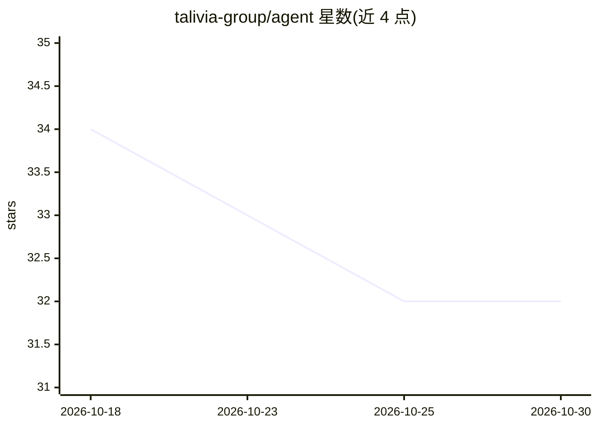

# talivia-group/agent

⭐ 32 · JavaScript · MIT · 推送 2026-10-01 · [GitHub](https://github.com/talivia-group/agent) · [官网](https://talivia.com/ai-agent-kit) · 组织维护

**让 AI agent 安装并验证收入归因网站分析的 MCP 工具包**

Talivia 是收入优先的网站分析服务，本仓库为其 Agent Kit：通过托管 MCP 端点或 npm 本地 stdio MCP 服务器，把 Codex、Claude Code 等 MCP 客户端接入 Talivia，让编码型 agent 在用户仓库内完成分析埋点安装、框架专属安装计划（Next.js/React/Astro/HTML）、事件到达验证与支付连接的收益归因检查。认证与授权在浏览器内完成，支付密钥不经聊天或 MCP 参数传递。产品逻辑放在托管 MCP 服务端，另有可自托管的开源版本。

## 筛选速览

| 维度 | 判定 | 备注 |
|---|---|---|
| AI 角色 | `ai-ecosystem` | LLM/agent 周边工具 |
| 许可风险 | `permissive` | MIT |
| 部署形态 | `library` | 以包/库形式分发 |
| 模型依赖 | — | README 未给出锁定关系 |
| 硬件要求 | — | 无带数字的原话,不猜 |
| 安装摩擦 | `low` | 无编译、无系统依赖或容器化 |
| 成熟度 | — | 结构信号不足 |

## 能力要点

- 托管 HTTP MCP 端点与 npm 本地 stdio MCP 服务器两种接入方式
- agent 可生成框架专属埋点安装计划并验证真实事件到达
- 支付连接与收益归因就绪检查，密钥不经 chat/MCP 传递
- 包含 Codex 插件清单与 SKILL.md 供 agent 发现

## 适用场景

- 让编码 agent 在我的项目里完成分析埋点的安装与验证
- 追踪哪些引荐来源、关键词和落地页带来了付费客户
- 上线前确认埋点与支付归因在生产环境实际工作

## 场景标签

 · 领域:网站分析/开发工具

## 证据(README 行号)

> L7: Talivia shows founders which referrers, campaigns, pages, search keywords, and customer journeys turn visits into re
> L53: Use the hosted website analytics MCP server when your client supports HTTP MCP and OAuth:
> L78: ```bash

## 星数曲线



2026-10-18 34 → 2026-10-30 32（-2）


---
*卡片 v1 · prompt 1.4 · 生成 2026-10-25 · 置信度 high · 依据 README sha `164feb5875eb` · [字段定义](../../DATASET.md)*
