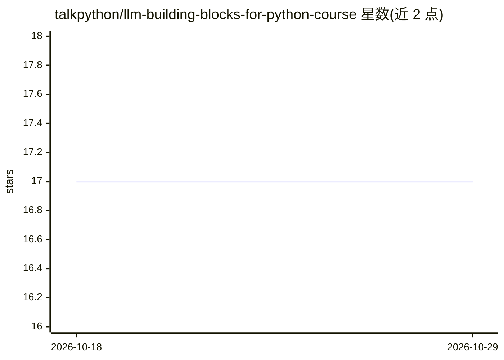

# talkpython/llm-building-blocks-for-python-course

⭐ 17 · Python · MIT · 推送 2025-11-17 · [GitHub](https://github.com/talkpython/llm-building-blocks-for-python-course) · [官网](https://training.talkpython.fm/courses/llm-building-blocks-for-python) · 组织维护

**Python LLM 集成视频课程：结构化输出、异步与缓存实践**

Talk Python 出品的 1.2 小时付费视频课程配套仓库，面向 Python 开发者、数据科学家与自动化工程师，讲授在 Python 应用中集成 LLM 的代码优先技巧：用 Pydantic schema 强制结构化 JSON 输出、程序化构建聊天会话、编排异步 LLM 调用与并发限制、磁盘缓存节省 token 与成本、提示词 A/B 测试，以及 LLM 与 scikit-learn 流水线的分类准确率对比。还涉及 Marimo 反应式笔记本实验与 smartfunk、Mirascope、Ollama、Instructor 等工具。

## 筛选速览

| 维度 | 判定 | 备注 |
|---|---|---|
| AI 角色 | `ai-knowledge` | 知识聚合/清单类 |
| 许可风险 | `permissive` | MIT |
| 部署形态 | `None` |  |
| 模型依赖 | — | README 未给出锁定关系 |
| 硬件要求 | — | 无带数字的原话,不猜 |
| 安装摩擦 | `low` | 无编译、无系统依赖或容器化 |
| 成熟度 | — | 结构信号不足 |

## 能力要点

- Pydantic schema 强制结构化 JSON 输出
- 异步 LLM 调用编排与磁盘缓存实践
- LLM 与 scikit-learn 流水线的基准对比
- Marimo 反应式笔记本内构建小型应用

## 适用场景

- 为脚本或 Web 应用添加 LLM 功能
- 在不深入 ML 的前提下原型化 NLP 工作流
- 将 AI 任务集成到自动化流水线中

## 场景标签

`教程课程` · 领域:学习与行业

## 证据(README 行号)

> L1: # LLM Building Blocks for Python Course
> L3: Dive into **LLM Building Blocks for Python**, a concise 1.2-hour video course that equips you with everything you ne

## 星数曲线

2026-10-18 17 → 2026-10-29 17（+0）

---
*卡片 v1 · prompt 1.4 · 生成 2026-10-29 · 置信度 high · 依据 README sha `b9439dff055e` · [字段定义](../../DATASET.md)*
