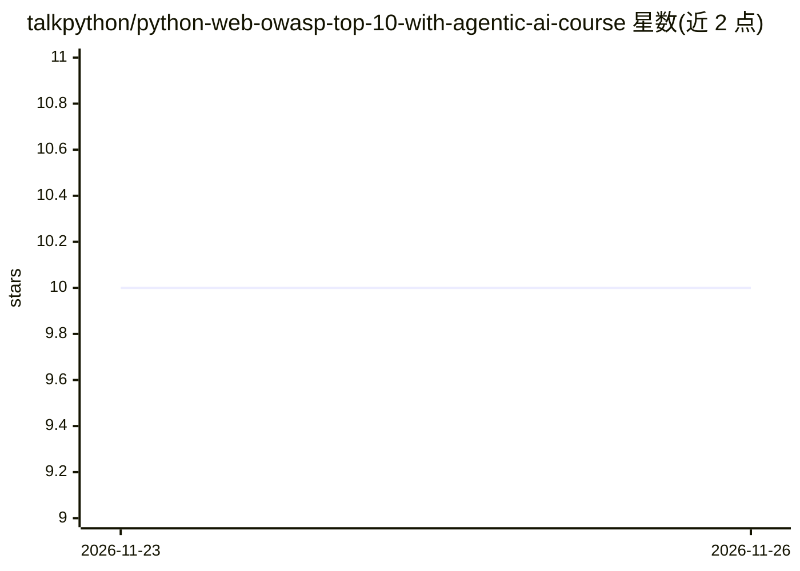

# talkpython/python-web-owasp-top-10-with-agentic-ai-course

⭐ 10 · Python · MIT · 推送 2026-05-12 · [GitHub](https://github.com/talkpython/python-web-owasp-top-10-with-agentic-ai-course) · 组织维护

**面向 Python 开发者的 OWASP Top 10 实战安全课程**

基于 2025 版 OWASP Top 10 的 Python Web 安全课程：以 Flask、Django、FastAPI 三种框架的真实漏洞代码为素材，逐项讲解风险原理并动手编写修复，覆盖访问控制、注入及 2025 新增的软件供应链失败与异常条件处理等类别。课程后半部分引入名为 'The Security Lead' 的 agentic AI 审计工具，对 Paperless-ngx、Apache Superset、kibitzr 等真实开源项目扫描漏洞并将发现映射回对应 OWASP 章节。以课程形式交付，供构建 API、部署 SaaS 或维护内部工具的开发者学习。

## 筛选速览

| 维度 | 判定 | 备注 |
|---|---|---|
| AI 角色 | `ai-knowledge` | 知识聚合/清单类 |
| 许可风险 | `permissive` | MIT |
| 部署形态 | `None` |  |
| 模型依赖 | — | README 未给出锁定关系 |
| 硬件要求 | — | 无带数字的原话,不猜 |
| 安装摩擦 | `low` | 无编译、无系统依赖或容器化 |
| 成熟度 | — | 结构信号不足 |

## 能力要点

- 按 2025 版 OWASP Top 10 逐项组织，含两个 2025 新类别
- 提供 Flask/Django/FastAPI 三框架的真实漏洞示例与修复实践
- 用 agentic AI 审计器扫描真实开源项目并回溯 OWASP 章节

## 适用场景

- 系统学习 Python Web 应用的 OWASP Top 10 防护
- 在自己团队代码库落地每章给出的安全模式
- 借助 AI 审计工作流检查真实项目中的安全漏洞

## 场景标签

`教程课程` `网络安全` · 领域:学习与行业

## 证据(README 行号)

> L1: # Python Web Security: OWASP Top 10 with Agentic AI course
> L5: We start with the freshly released OWASP Top 10 for 2025, the industry's definitive ranking of web application secur

## 星数曲线

2026-11-23 10 → 2026-11-26 10（+0）

---
*卡片 v1 · prompt 1.4 · 生成 2026-11-23 · 置信度 high · 依据 README sha `9fc629c8e7ea` · [字段定义](../../DATASET.md)*
