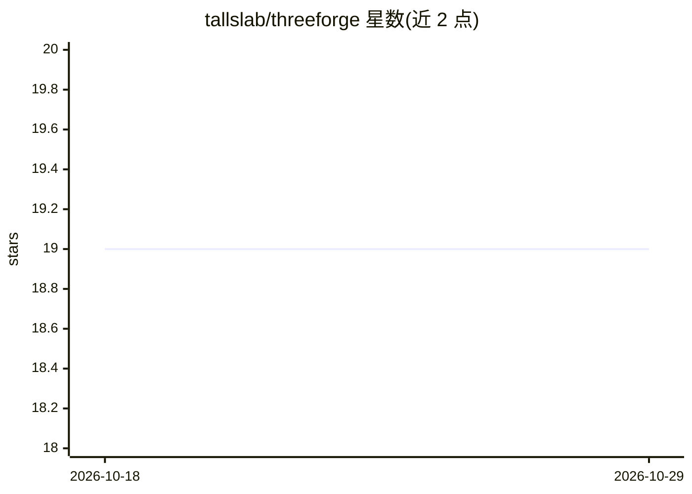

# tallslab/threeforge

⭐ 19 · TypeScript · MIT · 推送 2026-10-23 · [GitHub](https://github.com/tallslab/threeforge) · [官网](https://www.npmjs.com/package/threeforge) · 个人维护

**three.js 游戏的帧预算编译与诊断工具，含 CLI 与 MCP**

面向 three.js（r186，three/webgpu 及 WebGL2 回退）游戏的性能工具库：在加载时把朴素拼装的场景重写为批处理版本（材质注册表、静态合批、自动实例化、BVH 剔除、LOD、烘焙去缝等），并按绘制调用、过绘制、蒙皮、光照阴影、每帧 JS、内存加载六类成本逐帧测量，生成账本、提示与 JSON 报告。设备分档（desktop/phone-mid/phone-low）决定预算阈值。提供 npm CLI 命令（analyze/inspect/optimize/explain）与 MCP 通道供 AI agent 调用，附 8 个基准场景与公开 glTF 语料报告。已知限制：接缝与被埋面剔除假设相机不切入模块内部。

## 筛选速览

| 维度 | 判定 | 备注 |
|---|---|---|
| AI 角色 | `ai-enhanced` | 去掉 AI 部分产品仍成立 |
| 许可风险 | `permissive` | MIT |
| 部署形态 | `library` | 以包/库形式分发 |
| 模型依赖 | — | README 未给出锁定关系 |
| 硬件要求 | — | 无带数字的原话,不猜 |
| 安装摩擦 | `low` | 无编译、无系统依赖或容器化 |
| 成熟度 | — | 结构信号不足 |

## 能力要点

- 加载时将朴素场景重编译为合批场景（测试场景绘制提交从 503 降至 28）
- 六类成本账本逐帧测量，超标以提示形式输出到 overlay 与 JSON 报告
- CLI 命令输出 JSON 与退出码，供 AI agent 分支判断；另提供 MCP
- optimize 命令基于 glTF-Transform 重写资产并逐视图比对像素验证

## 适用场景

- three.js 游戏在桌面与手机上降低绘制调用、过绘制与内存占用
- AI agent 或 CI 通过 CLI/MCP 分析场景并获取可操作的修复提示
- 构建期优化 glb 资产（去重、量化、KTX2 纹理压缩）

## 场景标签

 · 领域:游戏开发/WebGL 性能优化

## 证据(README 行号)

> L3: Frame-budget compiler and diagnostics for three.js games (r186, `three/webgpu` with its WebGL2 fallback).
> L26: ## For AI agents (and anyone with a terminal)
> L29: npm i -D threeforge playwright && npx playwright install chromium

## 星数曲线

2026-10-18 19 → 2026-10-29 19（+0）

---
*卡片 v1 · prompt 1.4 · 生成 2026-10-28 · 置信度 high · 依据 README sha `d18d17a0f1ba` · [字段定义](../../DATASET.md)*
