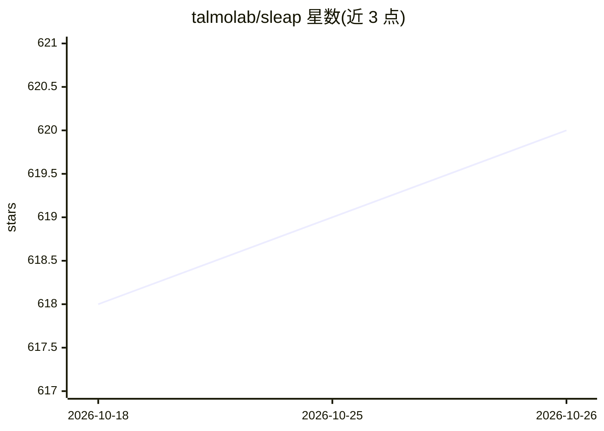

# talmolab/sleap

⭐ 620 · Python · BSD-3-Clause-Clear · 推送 2026-10-20 · [GitHub](https://github.com/talmolab/sleap) · [官网](https://sleap.ai) · 组织维护

**科研用深度学习多动物姿态追踪框架**

面向动物行为研究的开源深度学习框架，对任意种类、任意数量动物做姿态追踪与估计，支持 top-down 与 bottom-up 训练策略，并提供标注/训练/校对的一体化 GUI 与人在回路工作流。典型数据集单 GPU 训练 15-60 分钟，批量推理可达 600+ FPS，支持远程训练/推理（本地无 GPU 也可用）。以 Python 包安装，含 sleap-nn 与 sleap-io 两个独立后端，支持 Python 3.11-3.13，维护方为 Salk 研究所团队，成果发表于 Nature Methods 2022。

## 筛选速览

| 维度 | 判定 | 备注 |
|---|---|---|
| AI 角色 | `ai-native` | 本体是模型或模型工具 |
| 许可风险 | `viral` | BSD-3-Clause-Clear |
| 部署形态 | `desktop` | 安装包/桌面程序 |
| 模型依赖 | — | README 未给出锁定关系 |
| 硬件要求 | — | 无带数字的原话,不猜 |
| 安装摩擦 | `medium` | 含编译或系统依赖之一 |
| 成熟度 | — | 结构信号不足 |

## 能力要点

- 单/多动物姿态估计，top-down 与 bottom-up 两种训练策略
- 标注/训练/校对一体化 GUI，人在回路主动学习工作流
- 单 GPU 训练 15-60 分钟，批量推理可达 600+ FPS
- 支持远程训练/推理与开发者 API，独立 sleap-nn / sleap-io 后端

## 适用场景

- 给实验动物视频做多动物姿态追踪与行为量化
- 小标注量下训练姿态估计模型并用 GUI 校对
- 无本地 GPU 时通过远程流程训练和推理

## 场景标签

`科研工具` · 领域:学习与行业

## 证据(README 行号)

> L12: **SLEAP** is an open-source deep-learning based framework for multi-animal pose tracking (Pereira et al., Nature Me
> L18: * Single- and multi-animal pose estimation with *top-down* and *bottom-up* training strategies

## 星数曲线

2026-10-18 618 → 2026-10-26 620（+2）

---
*卡片 v1 · prompt 1.4 · 生成 2026-10-21 · 置信度 high · 依据 README sha `f2613b53c807` · [字段定义](../../DATASET.md)*
