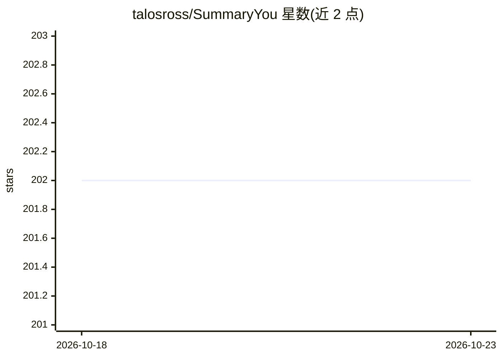

# talosross/SummaryYou

⭐ 202 · Kotlin · GPL-3.0 · 推送 2026-04-17 · [GitHub](https://github.com/talosross/SummaryYou) · [官网](https://play.google.com/store/apps/details?id=com.talosross.summaryyou) · 个人维护

**Android 应用：用 AI 总结视频、文章、图片与文档**

用 Kotlin/Jetpack Compose 编写的 Android 摘要应用：通过字幕/转录提取总结 YouTube 与 BiliBili 视频，抓取网页文章，处理 PDF、文本与图片（OCR），支持长短可调摘要、文本转语音、历史记录与付费墙检测。LLM 采用 BYOK 模式，支持 OpenAI、Gemini、Claude、DeepSeek、Mistral、Qwen、OpenRouter 与本地 Ollama 等供应方并允许自定义模型名。提供 Play Store 版（内置付费供应方）与 FOSS 版（GitHub Releases APK），界面支持 12 种语言。

## 筛选速览

| 维度 | 判定 | 备注 |
|---|---|---|
| AI 角色 | `ai-native` | 本体是模型或模型工具 |
| 许可风险 | `viral` | GPL-3.0 |
| 部署形态 | `None` |  |
| 模型依赖 | local-ok | 支持本地模型 |
| 硬件要求 | — | 无带数字的原话,不猜 |
| 安装摩擦 | `low` | 无编译、无系统依赖或容器化 |
| 成熟度 | — | 结构信号不足 |

## 能力要点

- YouTube/BiliBili 视频、网页文章、PDF 与图片（OCR）多源摘要
- BYOK 模式接入 8 类 LLM 供应方，含本地 Ollama，支持自定义模型名
- Play Store 与 FOSS 双构建变体，FOSS 版不依赖 Google Play Services
- 文本转语音、分享菜单直接摘要、付费墙检测与 12 种界面语言

## 适用场景

- 在手机上快速总结视频、文章或文档内容
- 通勤时用语音播报收听摘要
- 自带 API key 调用各家模型或本地模型生成摘要

## 场景标签

`语音合成` · 领域:内容生成

## 证据(README 行号)

> L3:  **Summarize YouTube Videos, Articles, Images and Documents with AI**
> L24: - 🎬 **YouTube & BiliBili** — Summarize videos via transcript/subtitle extraction
> L37: Bring Your Own Key (BYOK) — use any of these providers with your own API key:

## 星数曲线

2026-10-18 202 → 2026-10-23 202（+0）

---
*卡片 v1 · prompt 1.4 · 生成 2026-10-22 · 置信度 high · 依据 README sha `7889441be69f` · [字段定义](../../DATASET.md)*
