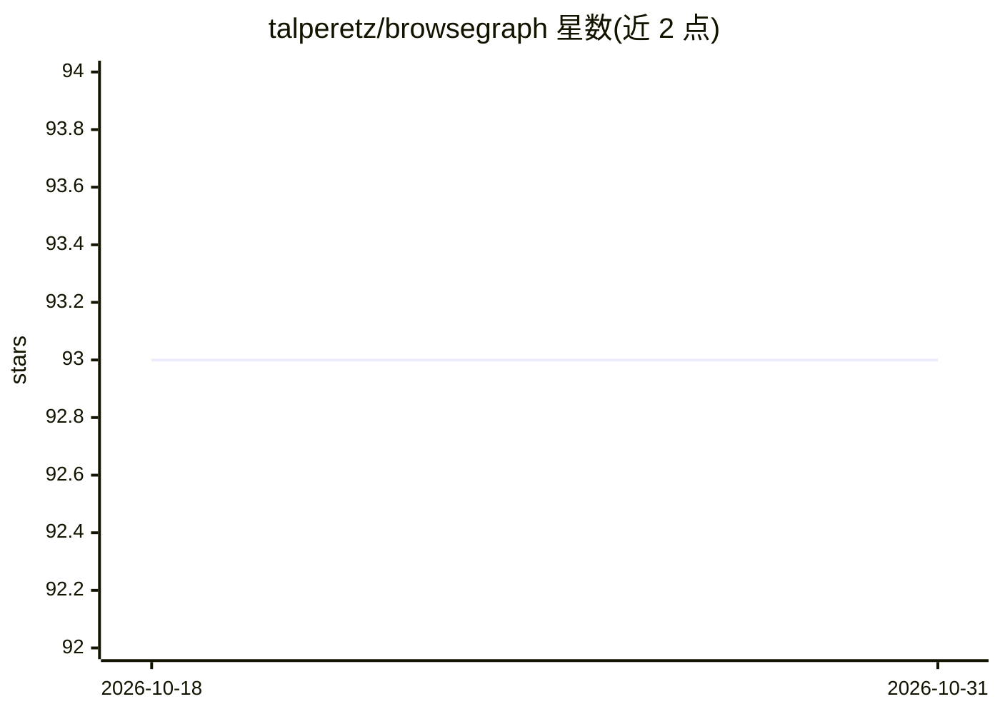

# talperetz/browsegraph

⭐ 93 · TypeScript · MIT · 推送 2026-02-13 · [GitHub](https://github.com/talperetz/browsegraph) · [官网](https://www.browsegraph.com/) · 个人维护

**浏览器内 GraphRAG 扩展：把浏览内容组织成可视化知识图谱**

Chrome 扩展，将用户浏览的网页自动构建为知识图谱并支持检索：本地优先处理，AI 计算（分类、摘要、个性化过滤）通过浏览器内 LLM（Gemini Nano + Chrome 内置 AI）在本地完成，向量存储采用 pglite + pgvector，图谱渲染使用 ReactFlow，搜索界面基于 cmdk。原始浏览数据不出浏览器，仅非敏感聚合数据上云做图变换。提供 git clone + pnpm 构建的手动安装方式，Chrome Web Store 上架列为待办。

## 筛选速览

| 维度 | 判定 | 备注 |
|---|---|---|
| AI 角色 | `ai-native` | 本体是模型或模型工具 |
| 许可风险 | `permissive` | MIT |
| 部署形态 | `library` | 以包/库形式分发 |
| 模型依赖 | — | README 未给出锁定关系 |
| 硬件要求 | — | 无带数字的原话,不猜 |
| 安装摩擦 | `low` | 无编译、无系统依赖或容器化 |
| 成熟度 | — | 结构信号不足 |

## 能力要点

- 浏览器内 LLM（Gemini Nano）本地完成分类、摘要与个性化过滤
- pglite + pgvector 浏览器内向量存储与检索
- ReactFlow 渲染并排知识图谱可视化
- 原始数据处理全部在本地，仅聚合数据上云

## 适用场景

- 把日常浏览内容自动沉淀为可检索的知识网络
- 在阅读网页时并排查看当前页的知识图谱
- 对浏览内容做基于个人兴趣的过滤与摘要索引

## 场景标签

`知识图谱` `知识库管理` · 领域:知识与检索

## 证据(README 行号)

> L9:  Introducing the first in-browser GraphRAG.
> L57: - **Local-First Processing**: All AI computations are performed locally within your browser using in-browser LLMs.
> L80: - **Local LLMs**: Gemini Nano + Chrome's built-in AI for private content classification, summarization, and persona

## 星数曲线

2026-10-18 93 → 2026-10-31 93（+0）

---
*卡片 v1 · prompt 1.4 · 生成 2026-10-23 · 置信度 mid · 依据 README sha `dac32c0ef3fe` · [字段定义](../../DATASET.md)*
