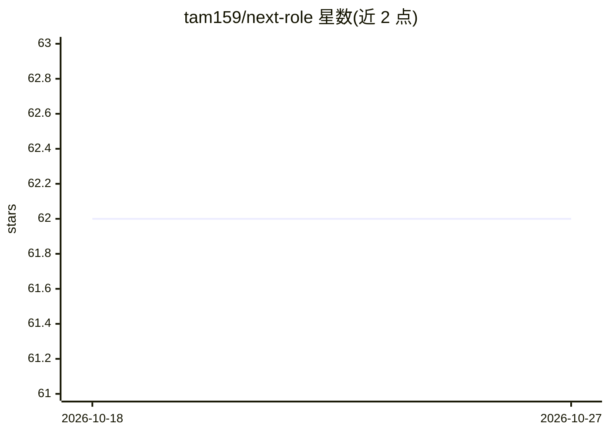

# tam159/next-role

⭐ 62 · Python · MIT · 推送 2026-10-25 · [GitHub](https://github.com/tam159/next-role) · [官网](https://next-role.dev) · 个人维护

**求职者上传 CV 与 JD，多 agent 生成定制简历与面试准备材料**

基于 LangGraph + DeepAgents 的自托管多 agent 职业准备应用：career agent 读取用户 CV 与职位描述（可粘贴 JD URL），分派研究、简历改写、面试教练三个子 agent，产出定制简历 PDF、公司调研、逐轮 STAR 故事、面试日 battlecard 与时间盒学习计划，支持对话式迭代修改。另有 analytics agent 通过只读 ClickHouse 查询回答产品自身使用问题。全栈（前端、后端、Postgres、Redis、对象存储、分析栈）以 Docker Compose 运行；模型可在应用内运行时切换，支持 OpenAI/Anthropic/Google 免费档及 Ollama/LM Studio 本地方案；需配置 OPENAI、TAVILY、LLAMA_CLOUD 等 API key。托管的 next-role.dev 标注即将上线。

## 筛选速览

| 维度 | 判定 | 备注 |
|---|---|---|
| AI 角色 | `ai-native` | 本体是模型或模型工具 |
| 许可风险 | `permissive` | MIT |
| 部署形态 | `self-host` | docker 或自建部署 |
| 模型依赖 | local-ok | 支持本地模型 |
| 硬件要求 | — | 无带数字的原话,不猜 |
| 安装摩擦 | `low` | 无编译、无系统依赖或容器化 |
| 成熟度 | — | 结构信号不足 |

## 能力要点

- career agent 分派 3 个专职子 agent 并行生成简历改写与面试教练内容
- 运行时可切换主/子 agent 模型，支持 Ollama/LM Studio 本地运行
- analytics agent 只读查询 ClickHouse 仓库并生成持久化图表
- 分析栈（ClickHouse/dbt/Cube/Superset/Dagster）随同一 compose 文件运行

## 适用场景

- 针对目标 JD 定制简历并生成面试逐轮准备材料
- 面试前快速生成公司调研与面试日速查卡
- 按 1 个月/2 周/3 小时生成时间盒备考计划
- 自部署后通过数据分析 agent 查看使用与成本指标

## 场景标签

`多智能体` `数据分析` `AI 写作` · 领域:Agent 开发

## 证据(README 行号)

> L11: **Upload your CV + a job description. Get a tailored resume PDF, a researched interview-prep doc, and a day-of batt
> L35: Preparing for an interview takes hours of tedious resume tailoring and company research. **NextRole automates the h

## 星数曲线

2026-10-18 62 → 2026-10-27 62（+0）

---
*卡片 v1 · prompt 1.4 · 生成 2026-10-24 · 置信度 mid · 依据 README sha `a12a0882a55b` · [字段定义](../../DATASET.md)*
