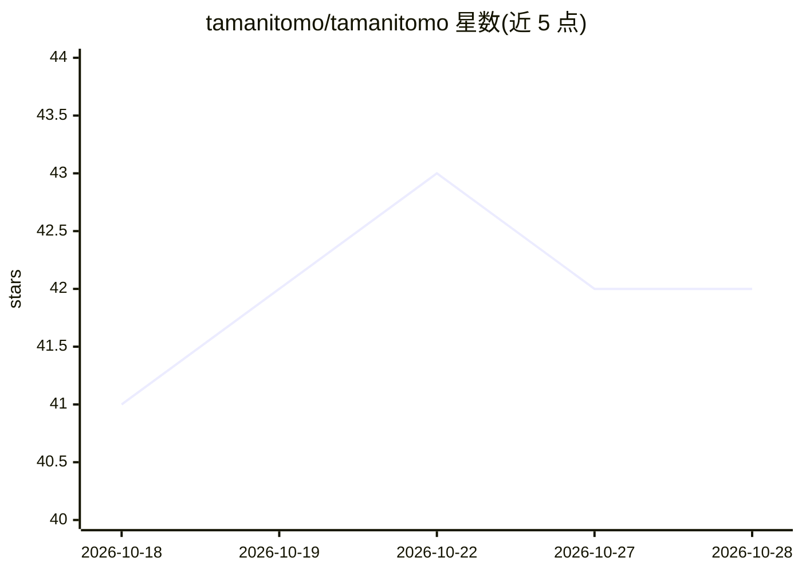

# tamanitomo/tamanitomo

⭐ 43 · Python · NOASSERTION · 推送 2026-10-16 · [GitHub](https://github.com/tamanitomo/tamanitomo) · 个人维护

**自托管 AI 陪伴应用：常驻本地、有记忆与日常作息**

基于 Hermes Agent 构建的自托管 AI 伴侣应用：用户自带模型，可连接本地端点（Ollama、LM Studio、vLLM）或云端 API（OpenRouter、Grok、DeepSeek、OpenAI）并支持自动故障切换。功能包括仅追加的记忆账本（事实需引用来源）、昼夜作息例程、夜间日记、通过 ComfyUI 或云端图像模型生成照片、Telegram 通道与语音对话、多伴侣档案。消息频率与静默时段由代码层 Outbox 守卫强制执行，数据保存于本机并自动 Git 备份。可在 Linux、Windows、macOS、Android Termux 上运行。许可证为 PolyForm Noncommercial 1.0.0，限非商业使用。

## 筛选速览

| 维度 | 判定 | 备注 |
|---|---|---|
| AI 角色 | `ai-native` | 本体是模型或模型工具 |
| 许可风险 | `none` | NOASSERTION |
| 部署形态 | `None` |  |
| 模型依赖 | local-ok | 支持本地模型 |
| 硬件要求 | — | 无带数字的原话,不猜 |
| 安装摩擦 | `low` | 无编译、无系统依赖或容器化 |
| 成熟度 | — | 结构信号不足 |

## 能力要点

- 本地记忆账本，事实需引用原文出处
- 代码层强制执行消息频率与静默时段限制
- 自带模型：本地端点或云 API，支持故障切换链
- 单安装可运行多个独立伴侣档案

## 适用场景

- 在自己的电脑或旧手机上 24/7 运行一个私有 AI 伴侣
- 通过 Telegram 或网页与伴侣聊天、收发语音与照片
- 不打上传数据到厂商云的前提下保留长期记忆

## 场景标签

`AI 助手` `语音 Agent` `图像生成` · 领域:对话与助手

## 证据(README 行号)

> L5:  Soul of a Friend — A sovereign, self-hosted AI companion that has a life when you close the window.
> L22: Your companion lives in a folder on your own computer, phone, or home server. It is backed by whatever model you ch
> L132: - **Bring your own weights**: Connect to local Ollama, LM Studio, or vLLM endpoints for a 100% offline companion, 

## 星数曲线

2026-10-18 41 → 2026-10-28 42（+1）

---
*卡片 v1 · prompt 1.4 · 生成 2026-10-25 · 置信度 high · 依据 README sha `6154c6498519` · [字段定义](../../DATASET.md)*
