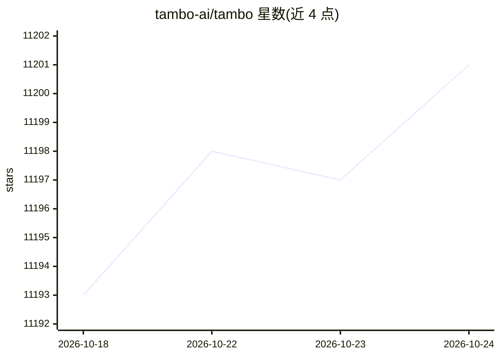

# tambo-ai/tambo

⭐ 11,201 · TypeScript · MIT · 推送 2026-10-23 · [GitHub](https://github.com/tambo-ai/tambo) · [官网](https://tambo.co) · 组织维护

**React 生成式 UI 工具包：让 agent 选择并流式渲染组件**

面向 React 开发者的开源生成式 UI 全栈方案：开发者用 Zod schema 注册组件，LLM 将其作为工具调用，Tambo 处理 props 流式传输、会话状态管理与 agent 执行循环；自带后端，可选 Tambo Cloud 托管或经 Docker 自托管。支持 OpenAI/Anthropic/Gemini/Mistral 等自带 API key 的提供商，兼容 MCP 协议（工具/提示/elicitation/sampling）与浏览器端本地工具，可与 LangChain、Mastra 搭配但非必需。注意：Tambo Cloud 将于 2026-10-31 停止服务，新注册已关闭，自托管路径保留。

## 筛选速览

| 维度 | 判定 | 备注 |
|---|---|---|
| AI 角色 | `ai-ecosystem` | LLM/agent 周边工具 |
| 许可风险 | `permissive` | MIT |
| 部署形态 | `None` |  |
| 模型依赖 | — | README 未给出锁定关系 |
| 硬件要求 | — | 无带数字的原话,不猜 |
| 安装摩擦 | `low` | 无编译、无系统依赖或容器化 |
| 成熟度 | — | 结构信号不足 |

## 能力要点

- Zod schema 注册组件，agent 自动选择并流式渲染 props
- 完整 MCP 协议支持（tools/prompts/elicitations/sampling）
- 可持久化的可交互组件（购物车、任务板等）
- 自带后端可 Docker 自托管，SDK 与后端为 MIT/Apache-2.0

## 适用场景

- 为聊天应用加入按用户意图动态生成的 UI 组件
- 构建由 agent 驱动并可交互操作的分析看板或任务板
- 通过 MCP 接入 Linear、Slack、数据库等外部系统

## 场景标签

`Agent 框架` · 领域:Agent 开发

## 证据(README 行号)

> L7:  The open-source generative UI toolkit for React. Connect your components—Tambo handles streaming, state management,
> L36: Tambo is a fullstack solution for adding generative UI to your app. You get a React SDK plus a backend that handles
> L38: **1. Agent included** — Tambo runs the LLM conversation loop for you. Bring your own API key (OpenAI, Anthropic, Ge

## 星数曲线

2026-10-18 11,193 → 2026-10-24 11,201（+8）

---
*卡片 v1 · prompt 1.4 · 生成 2026-10-20 · 置信度 high · 依据 README sha `93820502c846` · [字段定义](../../DATASET.md)*
