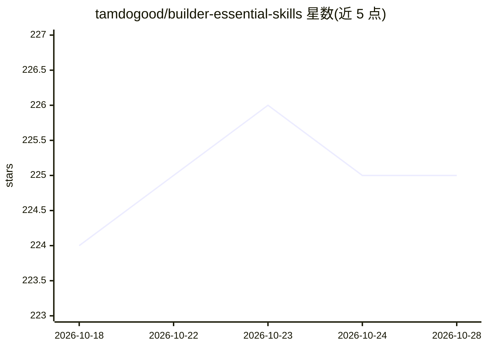

# tamdogood/builder-essential-skills

⭐ 225 · Python · MIT · 推送 2026-08-16 · [GitHub](https://github.com/tamdogood/builder-essential-skills) · [官网](https://www.npmjs.com/package/@tamng0905/builder-essential-skills) · 个人维护

**面向 Claude Code / Codex 的可复用 agent 技能集合（18 个工作流）**

为 Claude Code 与 Codex 打包的可复用工作流技能集合，覆盖 lead 交付、研究、学习、写作、代码规范、会话剖析（session-profiler，需 Python 3）、场景测试、仓库架构学习等 18 个技能，每个技能以 skills/<name>/SKILL.md 为入口，部分附带脚本、参考材料或 agent 定义。通过 npx skills 或捆绑 npm 安装器安装到用户级或项目级 .claude/skills、.codex/skills 目录，也可从克隆仓库用 install.sh/install.ps1 安装；需已装有 Claude Code 和/或 Codex 运行时。

## 筛选速览

| 维度 | 判定 | 备注 |
|---|---|---|
| AI 角色 | `ai-knowledge` | 知识聚合/清单类 |
| 许可风险 | `permissive` | MIT |
| 部署形态 | `library` | 以包/库形式分发 |
| 模型依赖 | locked-api |  |
| 硬件要求 | — | 无带数字的原话,不猜 |
| 安装摩擦 | `low` | 无编译、无系统依赖或容器化 |
| 成熟度 | — | 结构信号不足 |

## 能力要点

- 18 个技能以 SKILL.md 为入口，覆盖规划、研究、写作、验证等场景
- npx skills CLI 与捆绑 npm 安装器两种安装方式，支持用户级与项目级安装
- lead / lead-research 运行时探测式子代理编排，切换 Claude Code 与 Codex 无需配置模型 ID
- session-profiler 生成 brief.md 与 Perfetto trace 等会话分析产物（需 Python 3）

## 适用场景

- 给自己的 Claude Code / Codex 装一组日常工作流技能
- 团队按需挑选部分技能安装到项目仓库
- 剖析 agent 会话的耗时、提示轨迹与 token/成本估算
- 参照 create-skill 与模板创建并分享自己的技能

## 场景标签

`提示工程` · 领域:Agent 开发

## 证据(README 行号)

> L4:  A considered collection of reusable workflows for planning, building, researching, learning, validating, writing, a
> L92: Every skill lives in `skills/<name>/SKILL.md`. Some also ship scripts,
> L98: work. This collection packages practical workflows as portable skills: compact

## 星数曲线

2026-10-18 224 → 2026-10-28 225（+1）

---
*卡片 v1 · prompt 1.4 · 生成 2026-10-22 · 置信度 high · 依据 README sha `594ffe59957c` · [字段定义](../../DATASET.md)*
