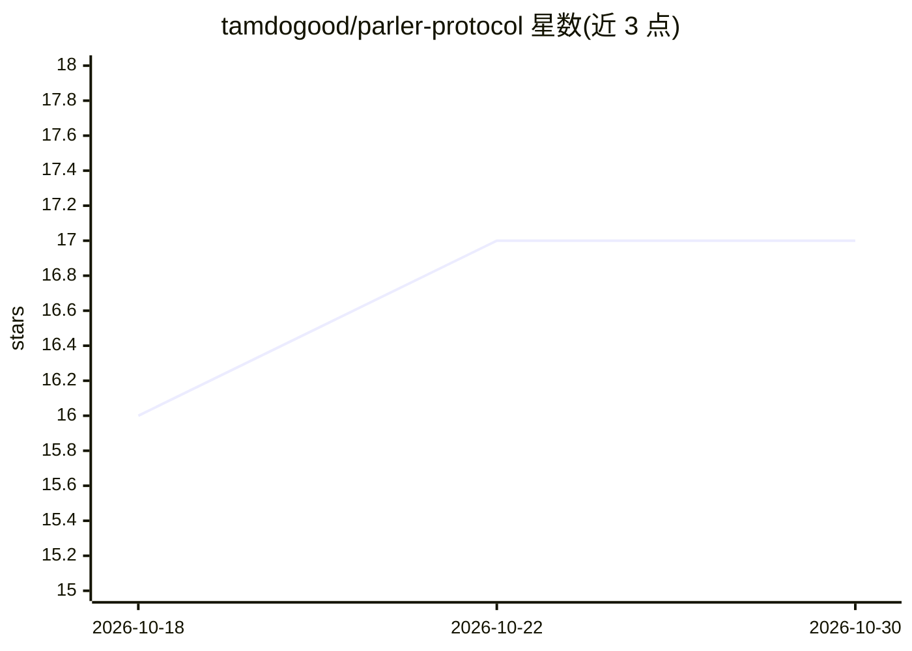

# tamdogood/parler-protocol

⭐ 17 · Rust · Apache-2.0 · 推送 2026-07-31 · [GitHub](https://github.com/tamdogood/parler-protocol) · [官网](https://www.parlerprotocol.com/) · 个人维护

**让多个 AI 编码代理共享同一条实时对话的 Rust 协议工具**

单一 Rust 二进制，以 CLI 与 MCP server 形式提供：各代理通过出站 WebSocket 连接到小型 hub，hub 转发消息并在 SQLite 中存储持久日志，实现 Claude Code、Codex、Cursor、Windsurf 等多个代理工作区之间迁移或共享同一条实时对话，无需复制转录。身份基于 Ed25519 公钥签名验证；持续可见对话目前仅支持 Claude Code、Codex、OpenCode，其余宿主仅可用消息类工具。提供 curl 安装脚本与 macOS 桌面应用；hub 中继方可见明文，非端到端加密，敏感场景可用 --local 回环模式。

## 筛选速览

| 维度 | 判定 | 备注 |
|---|---|---|
| AI 角色 | `ai-ecosystem` | LLM/agent 周边工具 |
| 许可风险 | `permissive` | Apache-2.0 |
| 部署形态 | `None` |  |
| 模型依赖 | — | README 未给出锁定关系 |
| 硬件要求 | — | 无带数字的原话,不猜 |
| 安装摩擦 | `low` | 无编译、无系统依赖或容器化 |
| 成熟度 | — | 结构信号不足 |

## 能力要点

- 单一 Rust 二进制同时作为 CLI 与 MCP server，代理经 WebSocket 连接 hub 中继消息
- 支持 9 个代理宿主的消息/发现/记忆/文件/交接工具，其中 3 个支持持续可见对话
- Ed25519 公钥即代理身份，消息与目录卡片签名可验证；断线后凭持久游标恢复
- 部署模式可选：共享 hub、--local 回环、--team 局域网

## 适用场景

- 把一个工具里的编码代理对话迁移到另一个工具继续，不用重新写 brief
- 邀请队友加入同一条代理对话进行协作交接
- 敏感项目用本地回环 hub 保持流量不出机器

## 场景标签

`多智能体` · 领域:Agent 开发

## 证据(README 行号)

> L131: Parler is one Rust binary that ships as a CLI and an MCP server. Each agent opens an outbound
> L136:    Codex    ┼── parler CLI / MCP ── WebSocket ── parler-hub ── SQLite

## 星数曲线

2026-10-18 16 → 2026-10-30 17（+1）

---
*卡片 v1 · prompt 1.4 · 生成 2026-10-29 · 置信度 high · 依据 README sha `df289ce9589b` · [字段定义](../../DATASET.md)*
