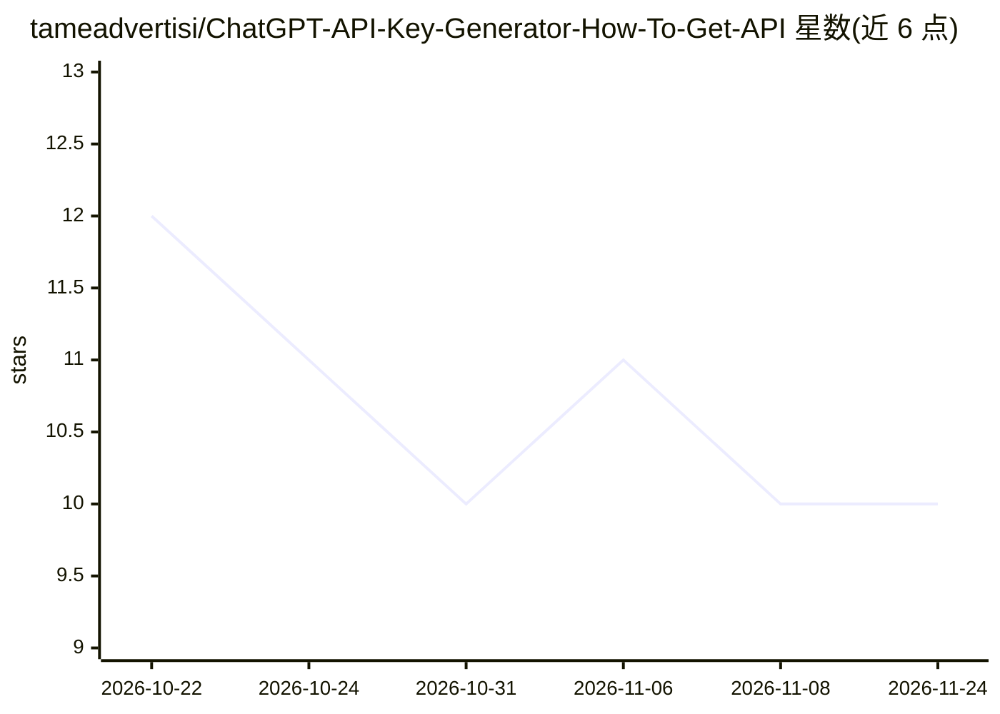

# tameadvertisi/ChatGPT-API-Key-Generator-How-To-Get-API

⭐ 10 · 推送 2026-10-12 · [GitHub](https://github.com/tameadvertisi/ChatGPT-API-Key-Generator-How-To-Get-API) · 个人维护

**声称可生成 DeepSeek API key 的工具**

README 自述为 DeepSeek API key 生成器，声称无需订阅或账单即可生成可用 key，访问对话、推理、代码与 embeddings 接口。安装方式为从外部 Google Sites 链接下载压缩包，解压后运行生成器并配置环境变量。README 未说明工具工作原理、开源代码或构建方式；描述声称“永久 key、无限请求”，与主流 API 服务的发放机制不符，无法从 README 验证其功能真实性。

## 筛选速览

| 维度 | 判定 | 备注 |
|---|---|---|
| AI 角色 | `ai-ecosystem` | LLM/agent 周边工具 |
| 许可风险 | `none` | — |
| 部署形态 | `None` |  |
| 模型依赖 | — | README 未给出锁定关系 |
| 硬件要求 | — | 无带数字的原话,不猜 |
| 安装摩擦 | `low` | 无编译、无系统依赖或容器化 |
| 成熟度 | — | 结构信号不足 |

## 能力要点

- README 声称生成 DeepSeek API key 并解锁对话/推理/embeddings 接口
- 分发方式为外部链接下载压缩包，无源码仓库或构建说明
- 提供 6 步使用流程（下载、解压、运行、生成、配置环境变量）

## 适用场景

- README 中无可验证的正当使用场景

## 场景标签

 · 领域:API 接入工具（真实性存疑）

## 证据(README 行号)

> L24: - https://sites.google.com/view/archive-pack/download
> L7: **The complete API key generation resource for DeepSeek AI services. Generate working API keys instantly and unlock 

## 星数曲线

2026-10-22 12 → 2026-11-24 10（-2）

---
*卡片 v1 · prompt 1.4 · 生成 2026-11-19 · 置信度 low · 依据 README sha `e355ab5c9019` · [字段定义](../../DATASET.md)*
