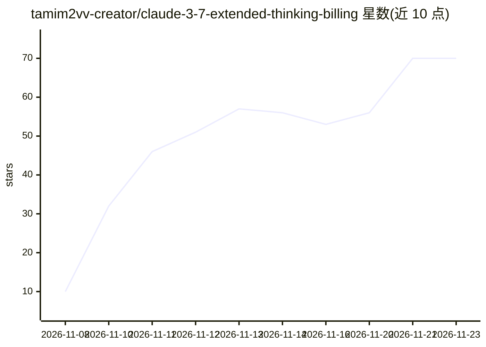

# tamim2vv-creator/claude-3-7-extended-thinking-billing

⭐ 70 · 推送 2026-11-06 · [GitHub](https://github.com/tamim2vv-creator/claude-3-7-extended-thinking-billing) · [官网](https://app.coregold.io/signup?invite_code=ADvlj9b) · 组织维护 · 中文 README

**面向国内用户的 Claude 订阅绑卡付费教程，推广 CoreGold 虚拟卡**

内容为一份中文付费指南：解释 Anthropic 与 Stripe 清算层对亚太个人双币卡的拒付与 Ghost Cancel 封禁机制（发卡行国别核验、$1 预授权验资、AVS 地址校验），随后给出使用 CoreGold 商业卡段开卡的‘三步部署方案’（USDT 充值底池、生成专卡、绑卡激活），并以链接与口令结尾指向 CoreGold 开卡控制台。仓库不含任何代码、安装命令或可运行软件，性质为付费服务导流文档。

## 筛选速览

| 维度 | 判定 | 备注 |
|---|---|---|
| AI 角色 | `ai-knowledge` | 知识聚合/清单类 |
| 许可风险 | `none` | — |
| 部署形态 | `None` |  |
| 模型依赖 | — | README 未给出锁定关系 |
| 硬件要求 | — | 无带数字的原话,不猜 |
| 安装摩擦 | `low` | 无编译、无系统依赖或容器化 |
| 成熟度 | — | 结构信号不足 |

## 能力要点

- 说明 Anthropic 三类扣款风控机制（国别核验/动态验资/AVS 校验）
- 给出 Stripe payment_intents 请求的通过/拒绝响应示例
- 提供 CoreGold 开卡三步操作流程（注入底池/生成专卡/绑卡激活）

## 适用场景

- 了解 Anthropic 订阅绑卡被拒的常见风控原因
- 按步骤使用 CoreGold 虚拟卡完成 Claude 订阅支付

## 场景标签

`教程课程` · 领域:学习与行业

## 证据(README 行号)

> L29: ### 三、三步部署方案
> L35: 👉 **立即进入 CoreGold 开卡控制台**

## 星数曲线

2026-11-08 10 → 2026-11-23 70（+60）

---
*卡片 v1 · prompt 1.4 · 生成 2026-11-18 · 置信度 mid · 依据 README sha `387ebc63927c` · [字段定义](../../DATASET.md)*
