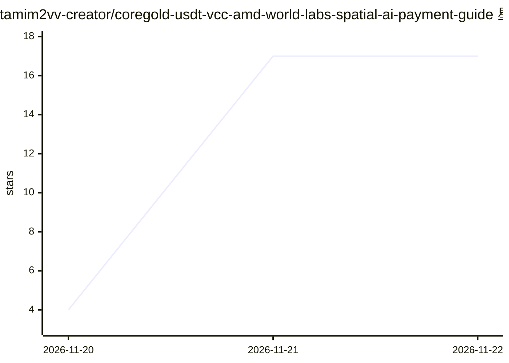

# tamim2vv-creator/coregold-usdt-vcc-amd-world-labs-spatial-ai-payment-guide

⭐ 17 · 推送 2026-11-19 · [GitHub](https://github.com/tamim2vv-creator/coregold-usdt-vcc-amd-world-labs-spatial-ai-payment-guide) · [官网](https://app.coregold.io/signup?invite_code=ADvlj9b) · 个人维护 · 中文 README

**面向订阅海外 AI 工具的用户：CoreGold 虚拟卡开卡与绑卡指南**

以 AMD 收购 World Labs、李飞飞出任首席科学家等新闻为切入背景，讨论开发者订阅 3D/空间 AI 与多模态海外工具时遇到的支付问题（银行卡不支持、扣款失败、账单地址填写），归纳账单地址一致性、分卡管理等用卡要点，并给出 CoreGold 虚拟卡的注册、USDT（TRC20）充值、选择套餐开卡、绑定 Apple Pay/Google Pay 的分步操作流程。内容为教程性质，CoreGold 为商业服务。

## 筛选速览

| 维度 | 判定 | 备注 |
|---|---|---|
| AI 角色 | `ai-knowledge` | 知识聚合/清单类 |
| 许可风险 | `none` | — |
| 部署形态 | `None` |  |
| 模型依赖 | — | README 未给出锁定关系 |
| 硬件要求 | — | 无带数字的原话,不猜 |
| 安装摩擦 | `low` | 无编译、无系统依赖或容器化 |
| 成熟度 | — | 结构信号不足 |

## 能力要点

- CoreGold 虚拟卡注册、充值、开卡、绑卡四步流程
- USDT（TRC20）入金方式与到账说明
- 账单地址（AVS）一致性与分卡管理建议
- Apple Pay / Google Pay 绑定步骤

## 适用场景

- 订阅海外 AI 工具时需要虚拟卡付款
- 用 USDT 给海外订阅充值
- 绑定数字钱包完成线上支付

## 场景标签

 · 领域:支付/虚拟卡使用指南

## 证据(README 行号)

> L2: 围绕 AMD 82 亿美元收购 World Labs 以及李飞飞出任首席科学家推动 3D 与空间智能爆发的热点，拆解 3D/空间 AI 与多模态工具订阅的支付痛点，并给出 CoreGold 虚拟卡极简开卡与数字钱包绑定指南。
> L11: ### 💡 干货拆解：海外订阅与多模态工具付款，最容易踩哪几个坑？
> L22: ### 🧭 傻瓜级开卡与绑卡教程（一看就会）

## 星数曲线

2026-11-20 4 → 2026-11-22 17（+13）

---
*卡片 v1 · prompt 1.4 · 生成 2026-11-21 · 置信度 mid · 依据 README sha `47f36da09ba0` · [字段定义](../../DATASET.md)*
