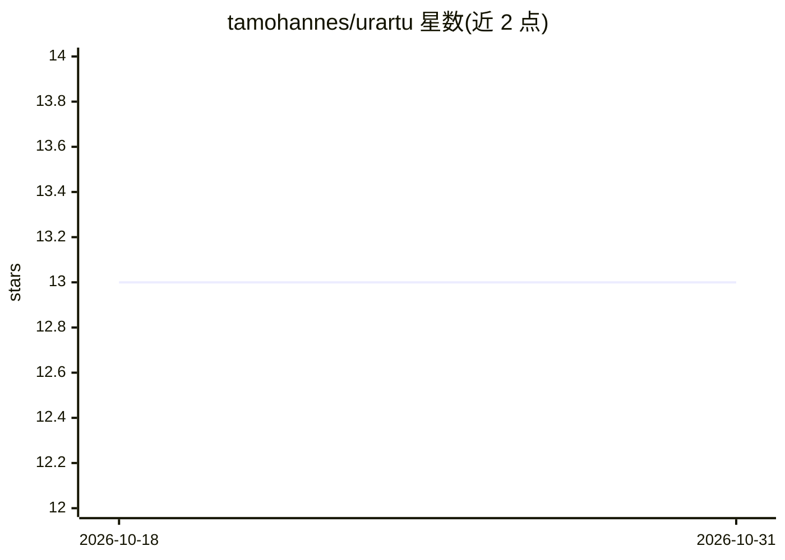

# tamohannes/urartu

⭐ 13 · Python · Apache-2.0 · 推送 2026-02-10 · [GitHub](https://github.com/tamohannes/urartu) · [官网](https://tamohannes.com) · 个人维护

**ML 工作流运行器：以 Pipeline/Action 组织实验并自动缓存**

面向研究与深度学习工作流的 Python 运行器：以 Pipelines（编排器）和 Actions（可复用步骤）组织 ML 任务，提供自动缓存、依赖注入、CLI 配置覆盖（如 seed、device）与配置组选择器。集成 Aim 进行实验跟踪，支持按用户目录组织 machine、slurm、aim 等配置，可本地开发并面向 HPC/Slurm 集群部署。缓存产物写入共享缓存目录，每次运行产物写入独立 run 目录。以 pip 包与源码两种方式安装。

## 筛选速览

| 维度 | 判定 | 备注 |
|---|---|---|
| AI 角色 | `ai-ecosystem` | LLM/agent 周边工具 |
| 许可风险 | `permissive` | Apache-2.0 |
| 部署形态 | `library` | 以包/库形式分发 |
| 模型依赖 | — | README 未给出锁定关系 |
| 硬件要求 | — | 无带数字的原话,不猜 |
| 安装摩擦 | `medium` | 含编译或系统依赖之一 |
| 成熟度 | — | 结构信号不足 |

## 能力要点

- Pipeline/Action 结构组织 ML 工作流，支持自动缓存与依赖注入
- CLI 覆盖参数与配置组选择器（machine/slurm/aim）
- 集成 Aim 实验跟踪
- 缓存产物与每次运行产物分目录管理

## 适用场景

- 组织可复现的机器学习实验流水线
- 本地开发后切换到 Slurm 集群配置运行
- 利用缓存避免重复计算并追踪实验指标

## 场景标签

`MLOps` · 领域:训练与推理

## 证据(README 行号)

> L7: Urartu is an ML workflow runner built around **Pipelines** (orchestrators) and **Actions** (reusable steps) with **a
> L39:     ├── aim/
> L91: urartu my_pipeline machine=local slurm=no_slurm aim=no_aim

## 星数曲线

2026-10-18 13 → 2026-10-31 13（+0）

---
*卡片 v1 · prompt 1.4 · 生成 2026-10-31 · 置信度 high · 依据 README sha `4c4c67473ede` · [字段定义](../../DATASET.md)*
