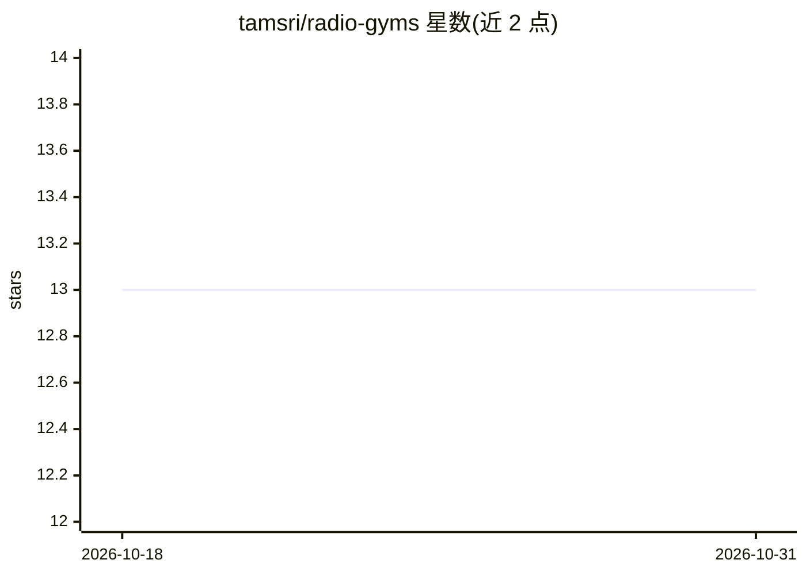

# tamsri/radio-gyms

⭐ 13 · Jupyter Notebook · MIT · 推送 2026-07-03 · [GitHub](https://github.com/tamsri/radio-gyms) · 个人维护

**面向无线通信的 AI 仿真环境工具包，支持强化学习**

开源 Python 工具包，提供构建无线通信仿真的模块：射线追踪引擎（Tracer）计算室外无线电传播路径，理论传播模型（如 TheoreticalOutdoorModel）预测接收信号强度与时延，并配套 3D 窗口可视化与 notebook 2D 绘图工具。仿真按 AI gym 形式构建，用于运行强化学习算法，面向无线通信与机器学习交叉领域的开发者与研究人员。依赖 Python 3.8+、numpy、pyglet、pywavefront。

## 筛选速览

| 维度 | 判定 | 备注 |
|---|---|---|
| AI 角色 | `ai-ecosystem` | LLM/agent 周边工具 |
| 许可风险 | `permissive` | MIT |
| 部署形态 | `library` | 以包/库形式分发 |
| 模型依赖 | — | README 未给出锁定关系 |
| 硬件要求 | — | 无带数字的原话,不猜 |
| 安装摩擦 | `low` | 无编译、无系统依赖或容器化 |
| 成熟度 | — | 结构信号不足 |

## 能力要点

- 射线追踪引擎计算室外无线电传播路径
- 理论传播模型预测信号强度与收发时延
- 3D 窗口可视化与 notebook 2D 俯视图渲染
- 以 gym 形式构建环境用于强化学习

## 适用场景

- 为强化学习算法搭建无线通信仿真环境
- 在城市场景中追踪并可视化电波传播路径
- 在 notebook 中渲染场景与传播路径进行分析

## 场景标签

`强化学习` · 领域:训练与推理

## 证据(README 行号)

> L5: Radio Gyms is an open-source bundle of AI environments for radio communications.
> L6: The simulations are built for AI gyms with the support of radio-related calculation modules, and theoretical radio p

## 星数曲线

2026-10-18 13 → 2026-10-31 13（+0）

---
*卡片 v1 · prompt 1.4 · 生成 2026-10-31 · 置信度 high · 依据 README sha `828a9f12afaa` · [字段定义](../../DATASET.md)*
