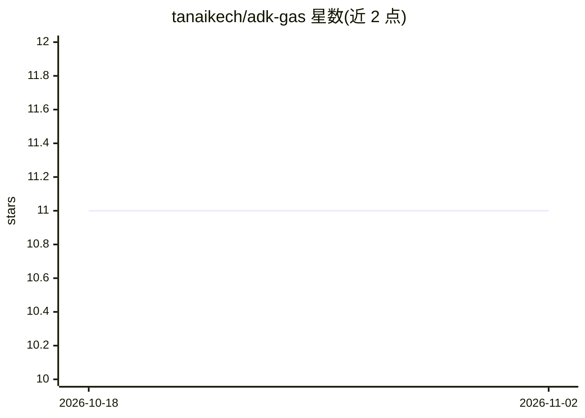

# tanaikech/adk-gas

⭐ 11 · JavaScript · MIT · 推送 2026-06-24 · [GitHub](https://github.com/tanaikech/adk-gas) · [官网](https://medium.com/google-cloud/agent-development-kit-for-google-apps-script-2413e97e8d84) · 个人维护

**面向 Google Apps Script 的 Agent 开发工具包，用 Gemini 构建 AI agent**

GASADK 是运行在 Google Apps Script 环境中的 Agent Development Kit，受 @google/adk 启发，针对 GAS 的 6 分钟执行上限与同步阻塞网络做了适配。核心 LlmAgent 采用 Planner-Executor-Synthesizer 三阶段架构，以 DAG 编排任务，支持原生 GAS 函数工具、MCP 服务器、A2A 跨 agent 通信、子 agent、Google Drive 中 .md 文件的 Agent Skills，以及 Python CodeExecutor 和 GoogleSearch 内置工具。通过 Gemini API Key 调用（默认 gemini-3.1-flash-lite），内置结果截断、280 秒强制中止、动态重规划等配额与超时保护。安装方式为 GAS 库引用或直接复制源码文件。

## 筛选速览

| 维度 | 判定 | 备注 |
|---|---|---|
| AI 角色 | `ai-ecosystem` | LLM/agent 周边工具 |
| 许可风险 | `permissive` | MIT |
| 部署形态 | `None` |  |
| 模型依赖 | — | README 未给出锁定关系 |
| 硬件要求 | — | 无带数字的原话,不猜 |
| 安装摩擦 | `low` | 无编译、无系统依赖或容器化 |
| 成熟度 | — | 结构信号不足 |

## 能力要点

- Planner-Executor-Synthesizer 三阶段 DAG 编排的 LlmAgent
- 原生集成 MCP 服务器、A2A 协议、子 agent 与 Markdown Agent Skills
- 面向 GAS 限制的保障：280s 强制中止、结果截断、动态重规划、One-Pass 快速通道
- 内置 Python CodeExecutor 与 GoogleSearch 工具

## 适用场景

- 在 Google Apps Script 项目中构建调用 Gemini 的 AI agent
- 将 Google Workspace API（Sheets/Drive/Docs 等）作为 MCP 工具暴露给 agent
- 通过 A2A 协议让本地 agent 调用远端自主 agent

## 场景标签

`Agent 框架` `多智能体` · 领域:Agent 开发

## 证据(README 行号)

> L5: Welcome to **GASADK**, the ultimate Agent Development Kit (ADK) designed specifically for the Google Apps Script (GA
> L7: Operating within the strict constraints of Google Apps Script—specifically the absolute 6-minute execution limit and
> L15: At the core of GASADK is the **LlmAgent**, powered by the **Planner-Executor-Synthesizer (PES)** architecture. It u

## 星数曲线

2026-10-18 11 → 2026-11-02 11（+0）

---
*卡片 v1 · prompt 1.4 · 生成 2026-11-01 · 置信度 high · 依据 README sha `fe140b1a3c4b` · [字段定义](../../DATASET.md)*
