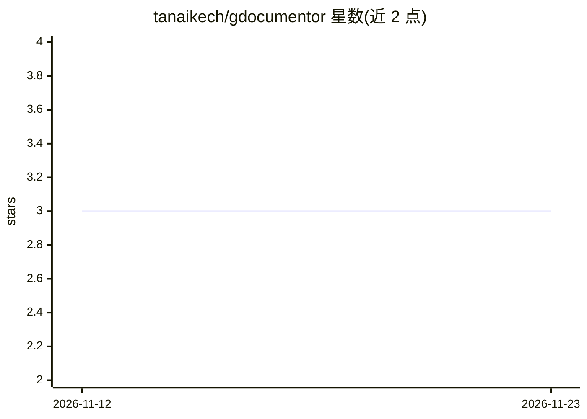

# tanaikech/gdocumentor

⭐ 3 · Go · 推送 2026-11-14 · [GitHub](https://github.com/tanaikech/gdocumentor) · [官网](https://medium.com/google-cloud/stop-passive-ai-rewrites-agentic-coaching-in-google-docs-with-gdocumentor-adcd606ec52f) · 个人维护

**苏格拉底式写作与代码评审教练，同时零 Token 编辑 Google Docs 的 Go CLI/MCP 服务器**

Go 编写的 CLI、MCP 服务器与 Antigravity Agent Skill 三合一工具，源自 Google Apps Script 版 DocuMentor AI。双执行架构：独立 CLI 模式直接调用 Gemini API；MCP 服务器模式复用宿主 AI 客户端（Antigravity、Claude Desktop、Cursor、Windsurf 等）的 LLM，自身无需 GEMINI_API_KEY。借助 Google Docs 原生建议与评论功能呈现修改理由，苏格拉底提示模式刻意不给改写答案以促学习者自改；支持 .md/.txt/.pdf/.docx 转换、本地文件与 GitHub URL 输入、批处理与 WSL2 桥接。

## 筛选速览

| 维度 | 判定 | 备注 |
|---|---|---|
| AI 角色 | `ai-native` | 本体是模型或模型工具 |
| 许可风险 | `permissive` | — |
| 部署形态 | `desktop` | 安装包/桌面程序 |
| 模型依赖 | — | README 未给出锁定关系 |
| 硬件要求 | — | 无带数字的原话,不猜 |
| 安装摩擦 | `low` | 无编译、无系统依赖或容器化 |
| 成熟度 | — | 结构信号不足 |

## 能力要点

- 双 AI 执行架构：CLI 内置 Gemini 调用 vs MCP 模式零 Token 使用宿主 LLM
- 通过 WriteMode.SUGGEST 与评论以 UTF-16 坐标安全应用内联建议
- 苏格拉底提示模式（--hint）仅给诊断与提示，不给改写答案
- gdocumentor setup 一条命令为 7 类 AI 客户端安装技能，支持 Windows↔WSL2 路径桥接

## 适用场景

- 教师批改几十份学生的 Google Docs 并批量下发提示与讲评摘要
- 在 Cursor/Claude Code 等客户端中接入 MCP 服务器做写作与代码评审
- 个人作者用 --no-auth 模式对本地文件或公开 URL 获取评审建议

## 场景标签

`代码审查` `AI 写作` · 领域:编码与开发

## 证据(README 行号)

> L13: **gdocumentor (`v1.1.0`, `DocuMentor AI`)** is a high-performance Golang CLI tool, **Global Model Context Protocol 
> L15: - **MCP Server Mode (`gdocumentor mcp`)**: Leverages the **client-side AI Agent's own LLM (Host AI)**—such as **Goo

## 星数曲线

2026-11-12 3 → 2026-11-23 3（+0）

---
*卡片 v1 · prompt 1.4 · 生成 2026-11-22 · 置信度 high · 依据 README sha `220939ad7007` · [字段定义](../../DATASET.md)*
