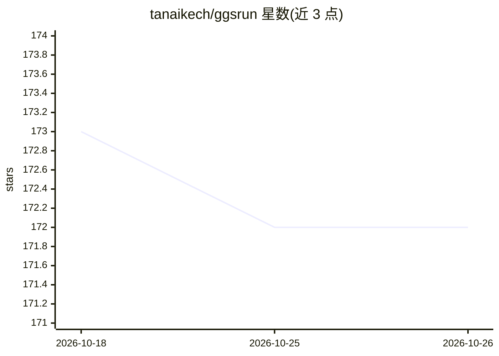

# tanaikech/ggsrun

⭐ 172 · Go · MIT · 推送 2026-08-26 · [GitHub](https://github.com/tanaikech/ggsrun) · 个人维护

**Google Drive CLI 与 MCP 服务器：本地执行 Google Apps Script 并管理 Drive 文件**

用 Go 编写的命令行工具兼 MCP 服务器，面向开发者和 LLM agent：本地终端或经由 MCP（`ggsrun mcp` 启动 JSON-RPC stdio 服务器）执行 Google Apps Script，并并发上传/下载 Google Drive 文件与文件夹、管理共享权限、搜索元数据。关键机制包括基于 channel 的并发 worker 池、指数退避自动重试、Shared Drives 支持、OAuth2/服务账户/直传 Access Token 三种认证，以及通过 `--sandbox` 白名单配置限制 Workspace API 的内存级安全沙箱。安装方式为 go install 或下载预编译二进制，也可作为 Antigravity CLI 插件安装；使用前需配置 GCP OAuth 凭据。

## 筛选速览

| 维度 | 判定 | 备注 |
|---|---|---|
| AI 角色 | `ai-ecosystem` | LLM/agent 周边工具 |
| 许可风险 | `permissive` | MIT |
| 部署形态 | `desktop` | 安装包/桌面程序 |
| 模型依赖 | — | README 未给出锁定关系 |
| 硬件要求 | — | 无带数字的原话,不猜 |
| 安装摩擦 | `low` | 无编译、无系统依赖或容器化 |
| 成熟度 | — | 结构信号不足 |

## 能力要点

- `ggsrun mcp` 以 JSON-RPC stdio 服务器形式向 LLM agent 提供搜索、传输与脚本执行工具
- 本地终端直接执行 GAS（inline/多行/管道/heredoc 多种传参方式）
- 并发 Drive 上传/下载（errgroup worker 池）与 429/5xx 指数退避自动重试
- 内存级安全沙箱（--sandbox + sandbox_config.json 白名单）限制 Workspace API

## 适用场景

- 在本地编辑器/终端中开发和执行 Google Apps Script，无需网页 IDE
- 让 Claude Desktop 等 AI agent 通过 MCP 自动操作 Google Drive 与 GAS
- 批量并发上传/下载 Drive 文件夹并保留目录结构
- CI/CD 流水线用 --accesstoken 直传令牌无配置执行脚本

## 场景标签

 · 领域:开发者工具/Google Workspace 自动化

## 证据(README 行号)

> L10: **ggsrun** is an enterprise-grade CLI application and Model Context Protocol (MCP) Server designed to relentlessly 
> L66: Running `ggsrun mcp` transforms the application into an autonomous JSON-RPC background server via standard I/O, all

## 星数曲线

2026-10-18 173 → 2026-10-26 172（-1）

---
*卡片 v1 · prompt 1.4 · 生成 2026-10-23 · 置信度 high · 依据 README sha `3d762b5f8e47` · [字段定义](../../DATASET.md)*
