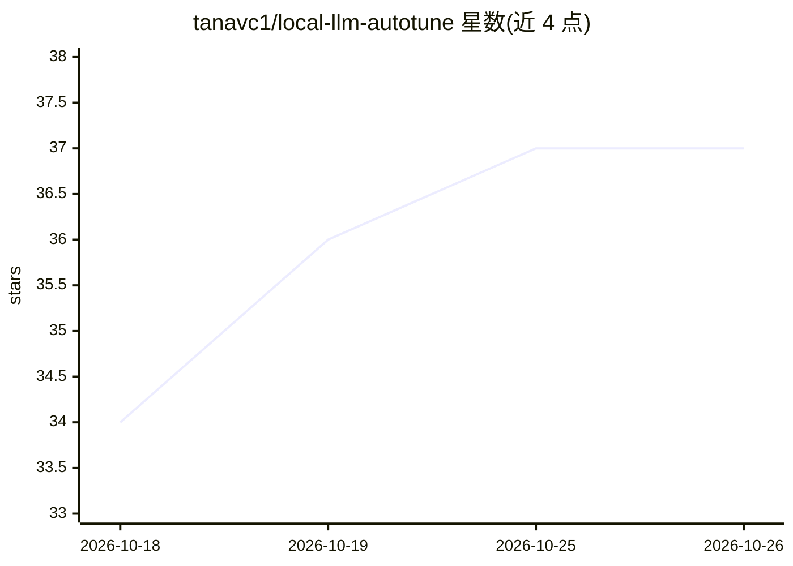

# tanavc1/local-llm-autotune

⭐ 37 · Python · MIT · 推送 2026-10-25 · [GitHub](https://github.com/tanavc1/local-llm-autotune) · [官网](https://www.autotunellm.com/) · 个人维护

**本地 LLM 推理优化中间件：降低 TTFT 与 KV 缓存内存**

面向 Ollama、LM Studio 与 Apple Silicon MLX 的中间件层：按请求计算精确 KV cache 大小、固定系统提示词于内存并自动管理上下文窗口，README 给出 Apple M2 16GB 上的基准数据（TTFT 平均降 39%，KV 缓存内存约降 67%，生成速度不变）。提供 autotune start 引导命令（检测 Ollama、分析硬件、拉取模型）、OpenAI 兼容 API 服务器（端口 8765）与内置监控仪表盘，支持 API key 认证、并发限制与设置热更新。以 pip/pipx/brew 安装，需 Python 3.9+ 与本地 Ollama。

## 筛选速览

| 维度 | 判定 | 备注 |
|---|---|---|
| AI 角色 | `ai-ecosystem` | LLM/agent 周边工具 |
| 许可风险 | `permissive` | MIT |
| 部署形态 | `self-host` | docker 或自建部署 |
| 模型依赖 | local-ok | 支持本地模型 |
| 硬件要求 | — | 无带数字的原话,不猜 |
| 安装摩擦 | `low` | 无编译、无系统依赖或容器化 |
| 成熟度 | — | 结构信号不足 |

## 能力要点

- 按请求计算精确 KV cache，替代固定 4,096-token 默认分配
- OpenAI 兼容 API 服务器与内置实时监控仪表盘
- autotune start 一键完成 Ollama 检测、硬件画像与模型拉取
- 43 个模型目录按本机硬件评分

## 适用场景

- 我在本地用 Ollama 跑模型时想降低首字延迟和内存占用
- 想给本地 LLM 加一层不改代码的优化与监控
- 在 Apple Silicon 上用 MLX 加速并管理 KV 缓存

## 场景标签

`推理引擎` `LLM 可观测性` · 领域:评测与运维

## 证据(README 行号)

> L14: autotune is a middleware layer that makes your local LLMs noticeably faster and lighter — without changing your cod
> L23: Works with **Ollama**, **LM Studio**, and **MLX** (Apple Silicon native) out of the box.

## 星数曲线

2026-10-18 34 → 2026-10-26 37（+3）

---
*卡片 v1 · prompt 1.4 · 生成 2026-10-25 · 置信度 mid · 依据 README sha `fc5b2a62c84a` · [字段定义](../../DATASET.md)*
