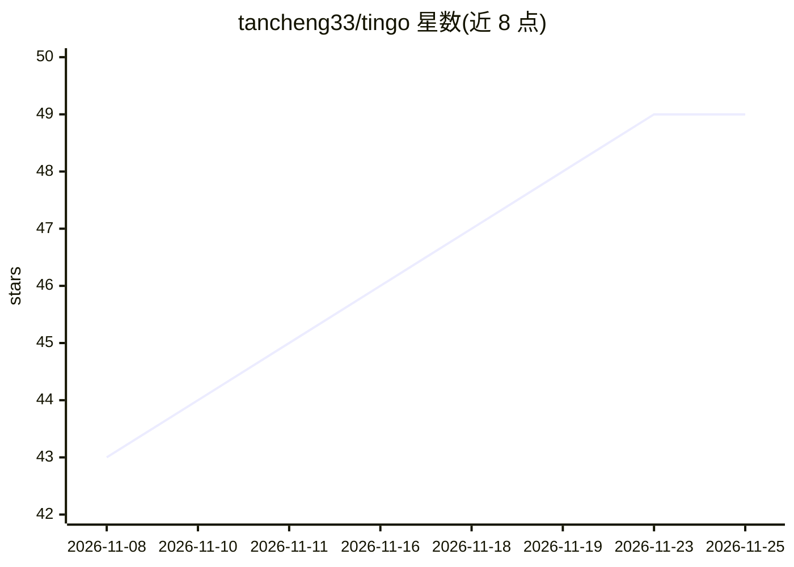

# tancheng33/tingo

⭐ 49 · Rust · MIT · 推送 2026-11-23 · [GitHub](https://github.com/tancheng33/tingo) · [官网](https://tancheng33.github.io/tingo/en.html) · 个人维护 · 中文 README

**给 Mac 用户的本地 AI 会议纪要：录音转文字、分说话人、出纪要**

面向中文会议场景的本地优先会议记录工具：录制腾讯会议/飞书/Zoom 的系统声音与麦克风，在本机用 FunASR 系模型（Paraformer-large/SenseVoice/Fun-ASR-Nano 可切换）转写并按声纹区分说话人，再交用户自选的大模型生成带时间戳的议题、决议、待办与风险纪要，并生成引用原话的鱼骨图。桌面版为 Tauri+Rust（仅 Apple 芯片 macOS 13+，录系统声需 macOS 15+），另有基于 Python+ffmpeg 的命令行版。录音不上传；生成纪要时转写文字发送至配置的大模型接口（可用本地 Ollama 全程离线）。

## 筛选速览

| 维度 | 判定 | 备注 |
|---|---|---|
| AI 角色 | `ai-native` | 本体是模型或模型工具 |
| 许可风险 | `permissive` | MIT |
| 部署形态 | `desktop` | 安装包/桌面程序 |
| 模型依赖 | local-ok | 支持本地模型 |
| 硬件要求 | — | 无带数字的原话,不猜 |
| 安装摩擦 | `medium` | 含编译或系统依赖之一 |
| 成熟度 | — | 结构信号不足 |

## 能力要点

- 录音与说话人区分全部在本地完成，识别模型离线运行
- 纪要每条带时间戳可跳回原话，鱼骨图分支绑定引用原文并标记无依据结论
- 支持任意 OpenAI 兼容接口与本地 Ollama，可全程断网
- 导出 PDF/Word/SRT/Obsidian，并可推送飞书/钉钉/企业微信群

## 适用场景

- 线上会议录音转文字并自动生成带待办的中文纪要
- 不上传录音的前提下留存会议记录并跨会议搜索原话
- 批量处理已有会议录音/录屏文件（命令行版）

## 场景标签

`语音识别` · 领域:感知与多模态

## 证据(README 行号)

> L15: 录下腾讯会议、飞书、Zoom 里的声音和你自己的麦克风，在你的电脑上转成文字、分清谁说了什么，再交给你自己选的大模型整理成纪要：议题、决议、带负责人和截止日期的待办、风险，讨论了"为什么"时还会画一张**每个分支都绑着原话的鱼骨图
> L17: - **录音不出本机**：识别、区分说话人都在本地完成，不上传录音。纪要可以用 DeepSeek、通义千问这类接口，也可以用本地 Ollama，全程断网。
> L18: - **为中文会议做的**：阿里达摩院 FunASR 的中文识别模型，中文标点、数字、人名都比通用的英文方案好；时间说法（"下周三""月底"）按会议日期换算成具体日子。

## 星数曲线

2026-11-08 43 → 2026-11-25 49（+6）

---
*卡片 v1 · prompt 1.4 · 生成 2026-11-18 · 置信度 mid · 依据 README sha `76654be58d10` · [字段定义](../../DATASET.md)*
