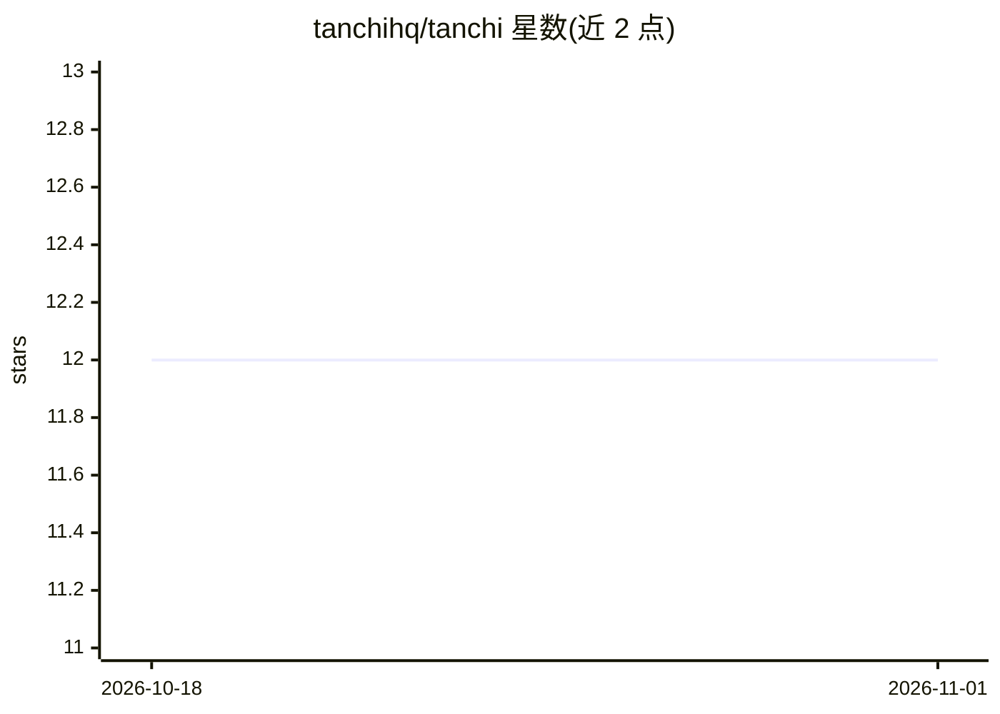

# tanchihq/tanchi

⭐ 12 · TypeScript · AGPL-3.0 · 推送 2026-09-25 · [GitHub](https://github.com/tanchihq/tanchi) · [官网](https://tanchi.io) · 组织维护

**自主 B2B 线索挖掘与外联引擎，夜间执行人工审核**

面向 B2B 销售的开源自主外联系统：AI 每晚执行线索搜寻、资料调研、邮件撰写与跟进，用户早晨以滑动队列方式审核（或开启邮件自动驾驶模式，含每日上限与退信暂停保护）。线索档案事实均取自潜在客户官网或 LinkedIn。技术栈为 Bun + Hono + PostgreSQL + Redis，前端 React，通过 Anthropic API 或 claude CLI 调用 Claude。支持 Docker 单容器试用与 docker compose 分服务部署，自托管，AGPL v3 许可。

## 筛选速览

| 维度 | 判定 | 备注 |
|---|---|---|
| AI 角色 | `ai-native` | 本体是模型或模型工具 |
| 许可风险 | `viral` | AGPL-3.0 |
| 部署形态 | `self-host` | docker 或自建部署 |
| 模型依赖 | locked-api |  |
| 硬件要求 | — | 无带数字的原话,不猜 |
| 安装摩擦 | `low` | 无编译、无系统依赖或容器化 |
| 成熟度 | — | 结构信号不足 |

## 能力要点

- 夜间自主执行线索搜寻、调研、撰写与跟进，早晨队列审核
- 邮件自动驾驶模式（默认关闭）：按邮箱每日上限发送并监测退信率
- 线索档案事实均来自潜在客户官网或 LinkedIn，附来源
- 单容器 Docker 部署，仅需 Docker 与 Anthropic API key

## 适用场景

- B2B 销售团队自动化邮件外联并保留人工审核控制
- 自托管销售线索挖掘系统，掌握客户数据
- 按 ICP 学习什么内容实际转化为回复和会议

## 场景标签

`工作流自动化` `网页抓取` `AI 写作` · 领域:效率与自动化

## 证据(README 行号)

> L5:  Autonomous B2B prospecting engine — open source, self-hostable.
> L6:  The AI sources, researches, writes and follows up every night. You stay in control of what gets sent.

## 星数曲线

2026-10-18 12 → 2026-11-01 12（+0）

---
*卡片 v1 · prompt 1.4 · 生成 2026-10-31 · 置信度 high · 依据 README sha `564fa039fbd7` · [字段定义](../../DATASET.md)*
