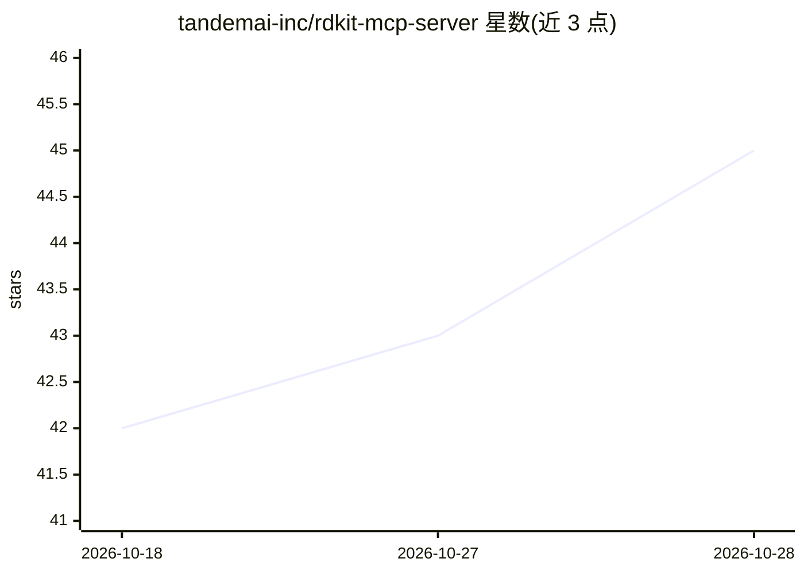

# tandemai-inc/rdkit-mcp-server

⭐ 45 · Python · MIT · 推送 2026-05-04 · [GitHub](https://github.com/tandemai-inc/rdkit-mcp-server) · [官网](https://tandemai.com) · 组织维护

**让语言模型通过自然语言调用 RDKit 的 MCP 服务器**

开源的 MCP（Model Context Protocol）服务器，把 RDKit 2025.3.1 的函数以工具形式暴露给支持 MCP 的语言模型，目标是无需写代码即可代理级访问 RDKit 功能。面向化学信息学与药物发现场景的开发者。附 CLI 客户端（基于 OpenAI）用于快速实验，提供工具列举脚本与基于 pydantic-evals 的评测套件，评测使用 LLMJudge 判断工具调用正确性。以 Python 包形式安装，运行时需提供设置文件。

## 筛选速览

| 维度 | 判定 | 备注 |
|---|---|---|
| AI 角色 | `ai-ecosystem` | LLM/agent 周边工具 |
| 许可风险 | `permissive` | MIT |
| 部署形态 | `library` | 以包/库形式分发 |
| 模型依赖 | — | README 未给出锁定关系 |
| 硬件要求 | — | 无带数字的原话,不猜 |
| 安装摩擦 | `low` | 无编译、无系统依赖或容器化 |
| 成熟度 | — | 结构信号不足 |

## 能力要点

- 通过 MCP 协议暴露 RDKit 2025.3.1 函数供 LLM 调用
- 兼容任何支持 MCP 协议的 LLM（如 Claude Desktop）
- 内置基于 OpenAI 的 CLI 客户端用于快速实验
- 提供 pydantic-evals 评测套件与 LLMJudge 评估

## 适用场景

- 让化学/药物发现场景的 LLM agent 直接调用 RDKit 计算工具
- 通过 CLI 客户端快速试验自然语言驱动的化学信息学操作
- 评测 agent 对 RDKit 工具调用的正确性

## 场景标签

 · 领域:化学信息学/LLM 工具接入

## 证据(README 行号)

> L3: RDKit MCP Server is an open-source MCP server that enables language models to interact with RDKit through natural la
> L7: * **Seamless Integration**: Exposes RDKit functions via the Model Context Protocol (MCP).

## 星数曲线

2026-10-18 42 → 2026-10-28 45（+3）

---
*卡片 v1 · prompt 1.4 · 生成 2026-10-25 · 置信度 high · 依据 README sha `4f1a3843baf9` · [字段定义](../../DATASET.md)*
