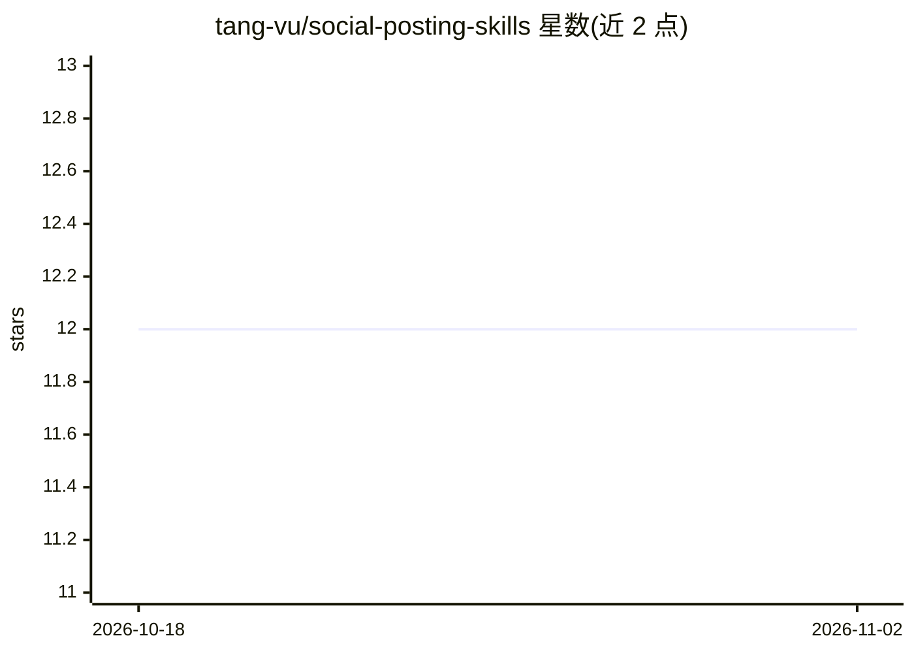

# tang-vu/social-posting-skills

⭐ 12 · JavaScript · MIT · 推送 2026-10-05 · [GitHub](https://github.com/tang-vu/social-posting-skills) · [官网](https://www.npmjs.com/package/social-posting-skills) · 个人维护

**面向 AI agent 的 12 平台社媒发帖技能与发布流水线**

以 SKILL.md 技能包为核心的社会化分发工具：读取 README/CHANGELOG/博客等源文件，构建内容图，按各平台文化差异生成 X、LinkedIn、Reddit、Show HN、Dev.to 等 12 平台的草稿，经逐条人工批准后通过 manual / agent-browser / API 三种模式发布；自动化失败时回退为可手工完成的草稿包。可被 Claude Code、Codex、Gemini CLI、Cursor 等 agent 调用，也可作为 CLI、JS 库或 MCP server 使用。API 适配器目前仅 Bluesky 与 Dev.to，本地优先、零凭据即可生成与预览。

## 筛选速览

| 维度 | 判定 | 备注 |
|---|---|---|
| AI 角色 | `ai-ecosystem` | LLM/agent 周边工具 |
| 许可风险 | `permissive` | MIT |
| 部署形态 | `library` | 以包/库形式分发 |
| 模型依赖 | — | README 未给出锁定关系 |
| 硬件要求 | — | 无带数字的原话,不猜 |
| 安装摩擦 | `low` | 无编译、无系统依赖或容器化 |
| 成熟度 | — | 结构信号不足 |

## 能力要点

- 一份源文件生成 12 平台差异化内容，发布前必须逐条人工批准
- manual / agent-browser / API 三种发布模式，失败回退草稿包
- MCP server 暴露 11 个工具，含 SSRF 防护的有界远程抓取
- 内容哈希去重、unknown 状态显式对账，反垃圾规则写入安全模型

## 适用场景

- 开源项目发布时把 README/CHANGELOG 变成多平台分发活动
- 让 Claude Code 等 agent 按剧本在浏览器中提交帖子
- 经预览与批准后通过 Bluesky/Dev.to API 发布

## 场景标签

`浏览器自动化` `AI 写作` · 领域:效率与自动化

## 证据(README 行号)

> L7: Built for Claude Code, Codex, Gemini CLI, Cursor, OpenCode, and any agent that reads `SKILL.md` files. Also usable a
> L35: Then ask your agent: *"Create a distribution campaign for README.md"* — the `social-campaign` skill drives the pipe
> L99: Tools: `create_campaign`, `adapt_content`, `preview_campaign`, `validate_platform_post`, `list_campaign_assets`, `p

## 星数曲线

2026-10-18 12 → 2026-11-02 12（+0）

---
*卡片 v1 · prompt 1.4 · 生成 2026-10-31 · 置信度 high · 依据 README sha `3f54dc38f573` · [字段定义](../../DATASET.md)*
