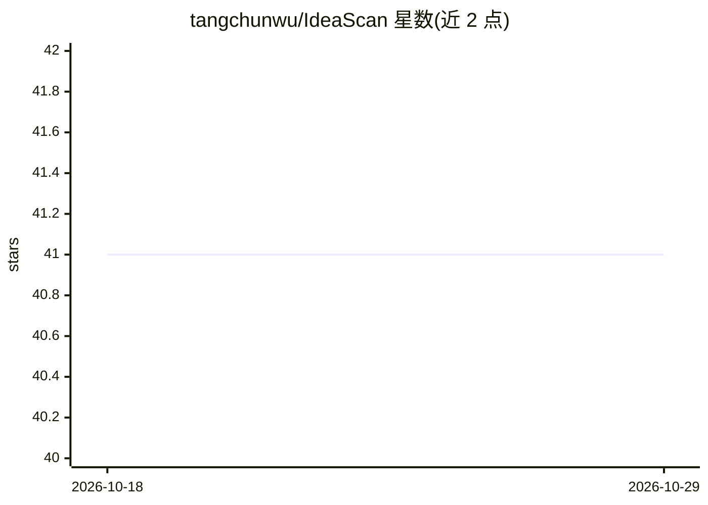

# tangchunwu/IdeaScan

⭐ 41 · TypeScript · 推送 2026-04-07 · [GitHub](https://github.com/tangchunwu/IdeaScan) · [官网](https://ideascan.lovable.app) · 个人维护 · 中文 README

**AI 创业点子验证平台：抓社媒痛点与竞品数据生成验证报告**

面向创业者的 Web 应用：输入想法后自动完成 LLM 关键词扩展、小红书/抖音等社媒数据抓取（自爬 Playwright 爬虫 + TikHub 第三方兜底）、竞品分析，输出多维评分、情感分析、痛点提取与证据可溯源的报告；另含热点雷达、一键生成 MVP 落地页并追踪 Waitlist/CTA 信号。前端 Vite+React，后端为 Lovable Cloud（Postgres/Deno Edge Functions），爬虫为独立 Python FastAPI 服务。爬虫与 LLM 配置为可选降级项，本地运行需 Node.js 18+，线上版本可直接访问。

## 筛选速览

| 维度 | 判定 | 备注 |
|---|---|---|
| AI 角色 | `ai-native` | 本体是模型或模型工具 |
| 许可风险 | `none` | — |
| 部署形态 | `library` | 以包/库形式分发 |
| 模型依赖 | — | README 未给出锁定关系 |
| 硬件要求 | — | 无带数字的原话,不猜 |
| 安装摩擦 | `low` | 无编译、无系统依赖或容器化 |
| 成熟度 | — | 结构信号不足 |

## 能力要点

- 关键词扩展→多平台抓取→AI 摘要→评分报告的端到端验证流程
- 自爬 + TikHub 双路由自动降级的数据采集
- 报告结论带证据等级（A/B/C/D）与数据质量评分，可回溯原始数据
- MVP 落地页一键生成并追踪 CTA 点击、Waitlist 提交等需求信号

## 适用场景

- 创业前快速验证一个点子的需求热度与竞争格局
- 通过热点雷达发现市场机会
- 生成 MVP 落地页收集真实用户需求信号

## 场景标签

`网页抓取` `数据分析` · 领域:效率与自动化

## 证据(README 行号)

> L3:  输入一个想法，自动完成关键词扩展 → 社媒数据抓取 → 竞品分析 → 生成可追踪验证报告
> L14: |**端到端验证**|从想法到报告一键完成：关键词扩展 → 多平台抓取 → 数据清洗 → AI 摘要 → 评分报告|
> L16: |**AI 深度分析**|多维评分（需求热度、竞争格局、可行性）、情感分析、痛点提取、用户画像|

## 星数曲线

2026-10-18 41 → 2026-10-29 41（+0）

---
*卡片 v1 · prompt 1.4 · 生成 2026-10-25 · 置信度 high · 依据 README sha `10e31ea40ead` · [字段定义](../../DATASET.md)*
