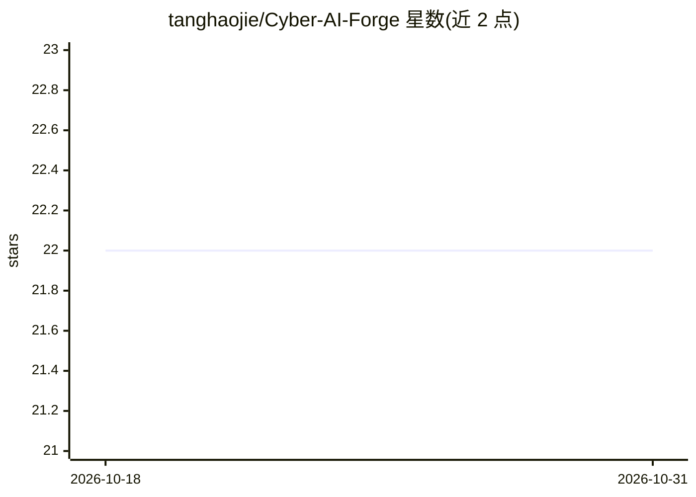

# tanghaojie/Cyber-AI-Forge

⭐ 22 · TypeScript · MIT · 推送 2026-10-07 · [GitHub](https://github.com/tanghaojie/Cyber-AI-Forge) · [官网](https://tanghaojie.github.io/Cyber-AI-Forge/) · 组织维护 · 中文 README

**面向人类与 AI 协作的 pnpm 全栈企业应用脚手架**

以 AI-Native 为定位的全栈脚手架：提供按 AI 协作组织的模块边界、公共接口、共享 Zod API 运行时契约与面向 AI 的项目文档（AGENTS.md、设计文档），使人类用自然语言描述需求、AI 完成数据库到页面的实现。内置登录认证、用户/角色/部门授权、动态菜单、字典、接口日志等管理后台基础能力。技术栈为 Vue3/NestJS/Drizzle/PostgreSQL，pnpm monorepo。限制：数据库绑定 PostgreSQL、初始迁移仅面向全新空库、无 CI 与生产部署基线、前端靠人工验收。

## 筛选速览

| 维度 | 判定 | 备注 |
|---|---|---|
| AI 角色 | `ai-ecosystem` | LLM/agent 周边工具 |
| 许可风险 | `permissive` | MIT |
| 部署形态 | `library` | 以包/库形式分发 |
| 模型依赖 | — | README 未给出锁定关系 |
| 硬件要求 | — | 无带数字的原话,不猜 |
| 安装摩擦 | `low` | 无编译、无系统依赖或容器化 |
| 成熟度 | — | 结构信号不足 |

## 能力要点

- 为 AI 理解组织的模块边界、公共接口与扩展路径
- 前后端共享 Zod 运行时契约，派生类型校验与 OpenAPI Schema
- 内置登录、用户/角色/部门授权、动态菜单、接口日志等系统能力
- 人类与 AI 共用的项目文档体系（AGENTS.md、设计文档、协作记录）

## 适用场景

- 不会写代码的人用自然语言让 AI 构建带登录权限的管理系统
- 开发者复用系统能力作为全栈项目起点，让 AI 在工程规则内协助开发
- 多人或多 AI 分工开发并合并到统一项目结构

## 场景标签

`代码生成` · 领域:编码与开发

## 证据(README 行号)

> L16: **Cyber AI Forge** 是一个以 `AI-Native Enterprise Application Scaffold` 为定位的 pnpm 全栈脚手架。
> L18: 它为 AI 准备了可理解的工程结构、清晰的模块边界、完整的后台基础能力，以及同时服务人类和 AI 的项目文档。即使几乎不会写代码，普通人也可以通过描述需求，让 AI 从数据库、接口到页面，逐步构建真实可运行的应用。
> L38: Cyber AI Forge 不是把 AI 接到一个普通脚手架上，而是从模块边界、文件职责、接口契约和扩展流程开始，就按照 AI 协作开发的方式组织项目。

## 星数曲线

2026-10-18 22 → 2026-10-31 22（+0）

---
*卡片 v1 · prompt 1.4 · 生成 2026-10-27 · 置信度 mid · 依据 README sha `7908adfde6a8` · [字段定义](../../DATASET.md)*
