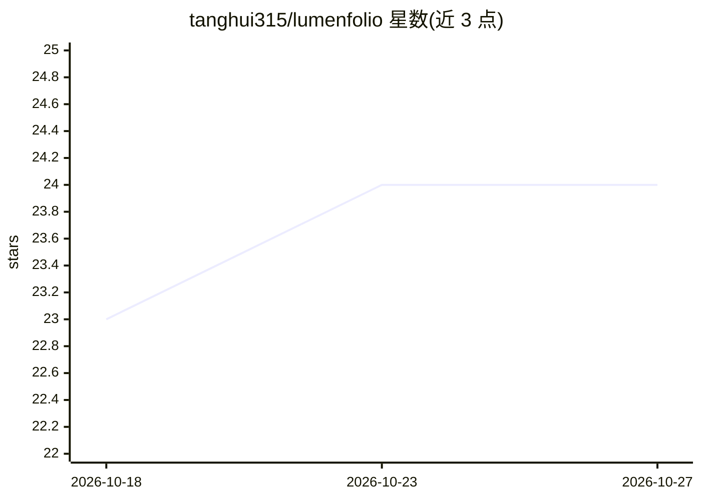

# tanghui315/lumenfolio

⭐ 24 · Rust · AGPL-3.0 · 推送 2026-09-03 · [GitHub](https://github.com/tanghui315/lumenfolio) · 个人维护 · 中文 README

**本地优先的桌面 AI 知识库：汇集文档笔记并可提问溯源**

面向个人用户的桌面知识库应用（macOS/Windows）：导入 PDF、Word/Excel/PowerPoint、网页剪藏与 Markdown 笔记，统一索引为一个可检索、可链接的本地图书馆；核心用法是对整个库提问，回答附带来源、页码与 bounding box 引用，点击可跳回原文位置。检索采用无向量化设计：文档结构树 + SQLite FTS5 + 页/块证据层，agent 通过检索工具多步取证后作答；无工具调用能力的模型走规则回退路径。另可将已登录的本地 Codex/Claude Code CLI 接为聊天模型，或通过只读 MCP 端点向外部工具开放知识库。笔记镜像为纯 .md 文件，数据库以快照备份，明确不做双向同步。

## 筛选速览

| 维度 | 判定 | 备注 |
|---|---|---|
| AI 角色 | `ai-native` | 本体是模型或模型工具 |
| 许可风险 | `viral` | AGPL-3.0 |
| 部署形态 | `library` | 以包/库形式分发 |
| 模型依赖 | — | README 未给出锁定关系 |
| 硬件要求 | — | 无带数字的原话,不猜 |
| 安装摩擦 | `low` | 无编译、无系统依赖或容器化 |
| 成熟度 | — | 结构信号不足 |

## 能力要点

- PDF/Office/网页/Markdown 统一索引为可提问的本地图书馆
- 引用携带页码与 bbox，点击跳回原文精确区域
- 无向量化 RAG：文档结构树 + SQLite FTS5（CJK 感知）+ 检索工具循环
- 本地 Codex / Claude Code CLI 可作为聊天模型，并提供只读 MCP Knowledge API

## 适用场景

- 把论文、Office 文档、网页剪藏和笔记集中到一个库里问答
- 阅读文献时获得可跳转回原文位置的带引用回答
- 用本地已登录的 Codex/Claude Code 对自己的知识库提问
- 用 Obsidian 风格的 wikilink 笔记建立跨文档知识关联

## 场景标签

 · 领域:知识管理/个人信息库

## 证据(README 行号)

> L3:  A local-first AI knowledge base — your second brain, fed by everything you read.
> L15: Lumenfolio is a local-first desktop knowledge base with an AI agent that can actually read it. You bring in sources
> L19: It is not "chat over a file". Answers are grounded in a local evidence layer — pages, blocks, chunks, structure, ta

## 星数曲线

2026-10-18 23 → 2026-10-27 24（+1）

---
*卡片 v1 · prompt 1.4 · 生成 2026-10-27 · 置信度 mid · 依据 README sha `d6cc1dbbaaaf` · [字段定义](../../DATASET.md)*
