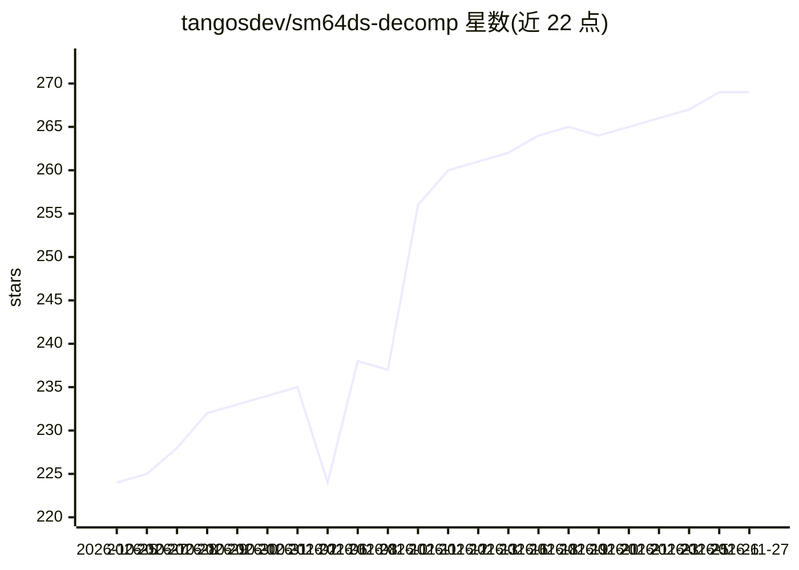

# tangosdev/sm64ds-decomp

⭐ 269 · C++ · MIT · 推送 2026-11-26 · [GitHub](https://github.com/tangosdev/sm64ds-decomp) · [官网](https://tangos.dev) · 组织维护

**面向逆向研究者的 SM64DS 完全反编译工程（C/C++）**

从零开始的 Super Mario 64 DS 字节级匹配反编译项目，将游戏还原为 C/C++ 源码。仓库只包含原创工作：工具链、手写源码与笔记，不含 ROM 与任天堂资产，所有构建针对用户自备的卡带转储在本地进行并 git-ignore。当前函数匹配进度 100%（11,389 个函数，其中 113 个为手写汇编），数据段进度 71.1%；提供 GitHub Pages 上的交互式进度 treemap、per-person 匹配计数及数据跟踪笔记。

## 筛选速览

| 维度 | 判定 | 备注 |
|---|---|---|
| AI 角色 | `ai-knowledge` | 知识聚合/清单类 |
| 许可风险 | `permissive` | MIT |
| 部署形态 | `None` |  |
| 模型依赖 | — | README 未给出锁定关系 |
| 硬件要求 | — | 无带数字的原话,不猜 |
| 安装摩擦 | `low` | 无编译、无系统依赖或容器化 |
| 成熟度 | — | 结构信号不足 |

## 能力要点

- 11,389 个函数 100% 匹配，其中 113 个为字节级手写汇编
- GitHub Pages 交互式进度 treemap，可按函数查看名称/地址/大小/状态
- 仅含原创工具链、源码与笔记，不含 ROM 与任天堂资产
- chaos-data 分支提供未匹配函数的注解反汇编文本供贡献者使用

## 适用场景

- 研究 Nintendo DS 平台的反编译与匹配工作流
- 在不持有完整本地环境的情况下认领未匹配函数的逆向工作
- 查阅 SM64DS 源码结构与翻译单元组织

## 场景标签

 · 领域:逆向工程/游戏反编译

## 证据(README 行号)

> L7: A decompilation of Super Mario 64 DS
> L20: MATCHED    ██████████████████████████████  100.0%   11,389 / 11,389 functions

## 星数曲线

2026-10-25 224 → 2026-11-27 269（+45）

---
*卡片 v1 · prompt 1.4 · 生成 2026-11-26 · 置信度 mid · 依据 README sha `a918e31d046f` · [字段定义](../../DATASET.md)*
