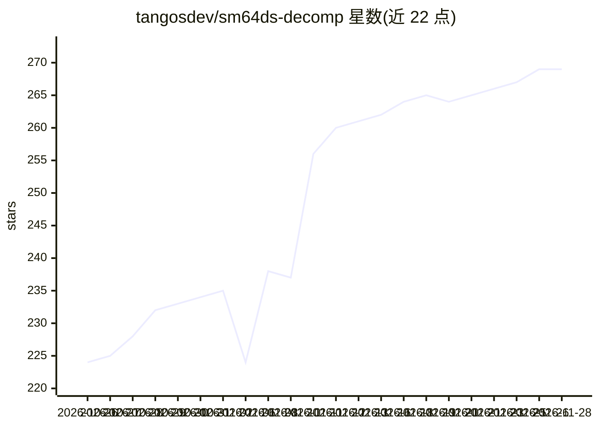

# tangosdev/sm64ds-decomp

⭐ 269 · C++ · MIT · 推送 2026-11-27 · [GitHub](https://github.com/tangosdev/sm64ds-decomp) · [官网](https://tangos.dev) · 组织维护

**将《超级马力欧64 DS》反编译为C/C++的匹配工程**

从零开始、逐字节匹配的 Super Mario 64 DS 反编译项目，产出 C/C++ 源码与配套匹配工具。仓库仅含原创的工具、手写源码与笔记，不含 ROM 或任天堂资产，运行时需用户自行提供卡带转储并在本地使用（已 git-ignore）。当前标注函数匹配进度为 100.0%（11,389 个函数，其中 113 个为手写汇编），链接进度 100.0%，数据进度 78.6%，并提供交互式进度树图与按人的实时匹配计数。贡献与法律范围条款见 README。

## 筛选速览

| 维度 | 判定 | 备注 |
|---|---|---|
| AI 角色 | `ai-enhanced` | 去掉 AI 部分产品仍成立 |
| 许可风险 | `permissive` | MIT |
| 部署形态 | `None` |  |
| 模型依赖 | — | README 未给出锁定关系 |
| 硬件要求 | — | 无带数字的原话,不猜 |
| 安装摩擦 | `low` | 无编译、无系统依赖或容器化 |
| 成熟度 | — | 结构信号不足 |

## 能力要点

- 11,389 个函数 MATCHED 100.0%，LINKED 100.0%（DATA 78.6%）
- 自备卡带转储运行，仓库不含 ROM 与任天堂资产
- 交互式进度树图（GitHub Pages），可按函数查看名称/地址/状态
- chaos-data 分支提供未匹配函数的注释反汇编文本

## 适用场景

- 想参与 Super Mario 64 DS 匹配反编译贡献
- 以自持卡带转储本地构建反编译产物
- 通过进度树图查看函数级匹配状态

## 场景标签

 · 领域:逆向工程/反编译

## 证据(README 行号)

> L7: A decompilation of Super Mario 64 DS
> L9: This repo holds source code and tooling. It contains no ROM and no Nintendo assets.

## 星数曲线

2026-10-26 224 → 2026-11-28 269（+45）

---
*卡片 v1 · prompt 1.4 · 生成 2026-11-28 · 置信度 low · 依据 README sha `bec726b467ad` · [字段定义](../../DATASET.md)*
