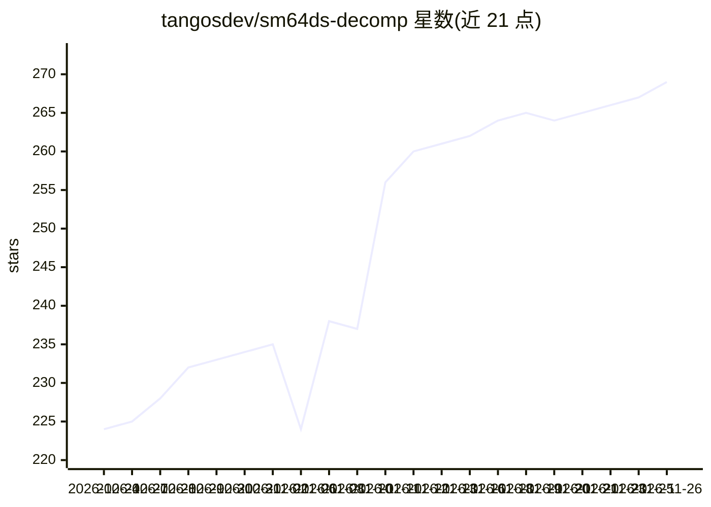

# tangosdev/sm64ds-decomp

⭐ 269 · C++ · MIT · 推送 2026-11-25 · [GitHub](https://github.com/tangosdev/sm64ds-decomp) · [官网](https://tangos.dev) · 组织维护

**为逆向研究者提供 SM64DS 的字节级等价 C/C++ 反编译源码与工具**

对 Super Mario 64 DS 进行从零开始的字节匹配反编译，将游戏代码重建为 C/C++ 源码。仓库只包含原创的工具链、手写源码与笔记，不含 ROM 和任天堂素材，运行需用户自行提供卡带镜像且该镜像被 git-ignore。提供实时进度图谱（函数匹配率、数据覆盖率）与可交互的 GitHub Pages 进度树，按翻译单元分组并链接到各源文件。当前报告 11,389 个函数全部 MATCHED。

## 筛选速览

| 维度 | 判定 | 备注 |
|---|---|---|
| AI 角色 | `ai-knowledge` | 知识聚合/清单类 |
| 许可风险 | `permissive` | MIT |
| 部署形态 | `None` |  |
| 模型依赖 | — | README 未给出锁定关系 |
| 硬件要求 | — | 无带数字的原话,不猜 |
| 安装摩擦 | `low` | 无编译、无系统依赖或容器化 |
| 成熟度 | — | 结构信号不足 |

## 能力要点

- 11,389 个函数 100% MATCHED，其中 113 个为手写汇编
- 提供可交互进度树图（按函数名/地址/大小/状态悬停查看）
- 仓库不含 ROM 与任天堂素材，全部针对用户自备卡带镜像运行
- chaos-data 分支提供未匹配函数的带注释反汇编文本供协作

## 适用场景

- 查看各函数的反编译匹配状态与翻译单元归属
- 在无完整本地环境的情况下认领未匹配函数的逆向工作
- 基于自备卡带镜像本地构建和验证反编译结果

## 场景标签

 · 领域:逆向工程/游戏反编译

## 证据(README 行号)

> L7: A decompilation of Super Mario 64 DS
> L9: This repo holds source code and tooling. It contains no ROM and no Nintendo assets.

## 星数曲线

2026-10-24 224 → 2026-11-26 269（+45）

---
*卡片 v1 · prompt 1.4 · 生成 2026-11-25 · 置信度 low · 依据 README sha `b1378aeffc7e` · [字段定义](../../DATASET.md)*
