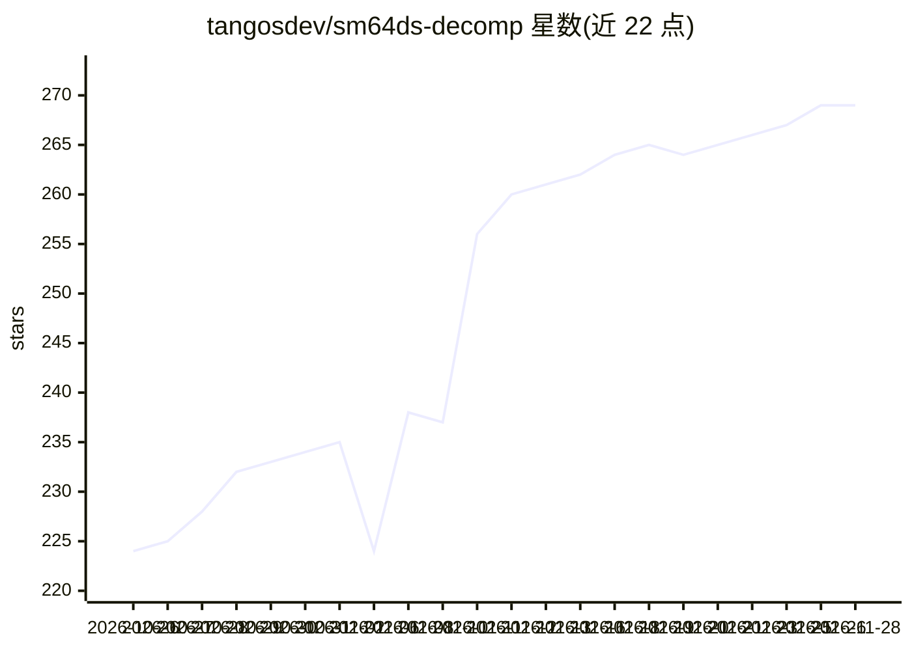

# tangosdev/sm64ds-decomp

⭐ 269 · C++ · MIT · 推送 2026-11-27 · [GitHub](https://github.com/tangosdev/sm64ds-decomp) · [官网](https://tangos.dev) · 组织维护

**Super Mario 64 DS 的字节级等价 C/C++ 反编译项目**

从零开始将 Super Mario 64 DS 反编译为 C/C++ 的逆向工程仓库，目标是与原版 ROM 字节匹配。仓库本身只包含源代码、工具与笔记，不含 ROM 和任天堂资产，一切运行都依赖用户自备的自有卡带 dump（git-ignored）。进度显示 11,389 个函数已全部匹配并链接，数据进度 78.5%，提供交互式进度树图、按贡献者统计匹配数的 contributions.json，以及 unmatched 函数的反汇编文本协作分支。

## 筛选速览

| 维度 | 判定 | 备注 |
|---|---|---|
| AI 角色 | `ai-enhanced` | 去掉 AI 部分产品仍成立 |
| 许可风险 | `permissive` | MIT |
| 部署形态 | `None` |  |
| 模型依赖 | — | README 未给出锁定关系 |
| 硬件要求 | — | 无带数字的原话,不猜 |
| 安装摩擦 | `low` | 无编译、无系统依赖或容器化 |
| 成熟度 | — | 结构信号不足 |

## 能力要点

- 11,389/11,389 函数 MATCHED 并 LINKED，其中 113 个为手写汇编
- 交互式进度树图按翻译单元分组并链接源文件与清单
- 仓库不含 ROM/资产，运行依赖用户自有卡带 dump
- chaos-data 分支提供未匹配函数的带注释反汇编文本

## 适用场景

- 参与逆向工程并按未匹配函数认领工作
- 基于自备卡带 dump 构建字节级匹配的原版等效代码
- 通过进度树图查看函数级反编译状态

## 场景标签

 · 领域:逆向工程/游戏反编译

## 证据(README 行号)

> L7: A decompilation of Super Mario 64 DS
> L42: This repo contains only original work: the tooling, the hand-written source, and the

## 星数曲线

2026-10-26 224 → 2026-11-28 269（+45）

---
*卡片 v1 · prompt 1.4 · 生成 2026-11-27 · 置信度 mid · 依据 README sha `96e684696e71` · [字段定义](../../DATASET.md)*
