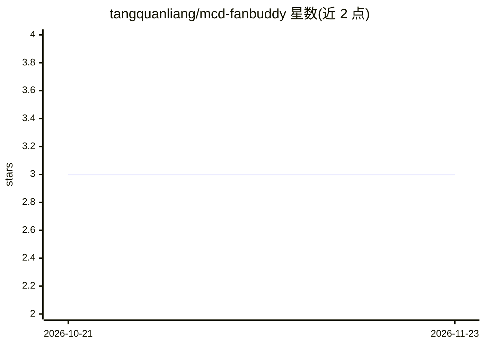

# tangquanliang/mcd-fanbuddy

⭐ 3 · MIT · 推送 2026-10-18 · [GitHub](https://github.com/tangquanliang/mcd-fanbuddy) · 个人维护 · 中文 README

**帮麦当劳顾客一句话算出今天最划算吃法的点餐决策助手**

基于麦当劳中国 MCP 服务与腾讯 WorkBuddy 的智能点餐决策助手，将营销活动日历、用户券包、当前时间与 160+ 款餐品营养数据融合，输出一句话点单决策。核心机制是调用麦当劳 MCP 的 35 个工具（时间查询、活动日历、券查询与领取、门店与算价、营养筛选），支持热量预算内的双目标搭餐，并通过 WorkBuddy 自动化在饭点推送攻略。以 SKILL.md 技能形式安装到 WorkBuddy 等客户端使用，需先获取麦当劳 MCP Token 并配置 MCP Server。

## 筛选速览

| 维度 | 判定 | 备注 |
|---|---|---|
| AI 角色 | `ai-native` | 本体是模型或模型工具 |
| 许可风险 | `permissive` | MIT |
| 部署形态 | `None` |  |
| 模型依赖 | — | README 未给出锁定关系 |
| 硬件要求 | — | 无带数字的原话,不猜 |
| 安装摩擦 | `low` | 无编译、无系统依赖或容器化 |
| 成熟度 | — | 结构信号不足 |

## 能力要点

- 融合活动日历×券包×时间×营养数据给出点单决策
- 从 160+ 款餐品营养数据中按热量预算筛选搭餐方案
- 用 calculate-price 计算含优惠实付价，节省金额可验证
- WorkBuddy 自动化在每天 11:00/17:00 推送攻略

## 适用场景

- 饭点前问一句“今天麦麦怎么吃最划算”拿到点单方案
- 减脂期在热量预算内挑选高蛋白餐品组合
- 管理券包并接收临期预警、一键领取可领券
- 设置每天饭点自动推送当日优惠攻略

## 场景标签

 · 领域:生活消费/餐饮决策

## 证据(README 行号)

> L17: 麦麦饭搭子是基于 麦当劳中国 MCP 服务 与 腾讯 WorkBuddy 开发的智能点餐决策助手。它不是优惠券列表——它把「营销活动日历 × 你的券包 × 当前时间 × 餐品营养数据」融合起来，直接给出**今天最划算（且可能最扛饿
> L23: |🍟 **饭点推荐**|综合时间/活动/你的券，给一句话点单决策|`now-time-info` `campaign-calendar` `query-my-coupons`|
> L96: 将本仓库的 `SKILL.md`（及配套文件）放入你的 WorkBuddy 技能目录，对话中说「**今天麦麦怎么吃**」即可唤醒。

## 星数曲线

2026-10-21 3 → 2026-11-23 3（+0）

---
*卡片 v1 · prompt 1.4 · 生成 2026-11-21 · 置信度 high · 依据 README sha `0b24486a9923` · [字段定义](../../DATASET.md)*
