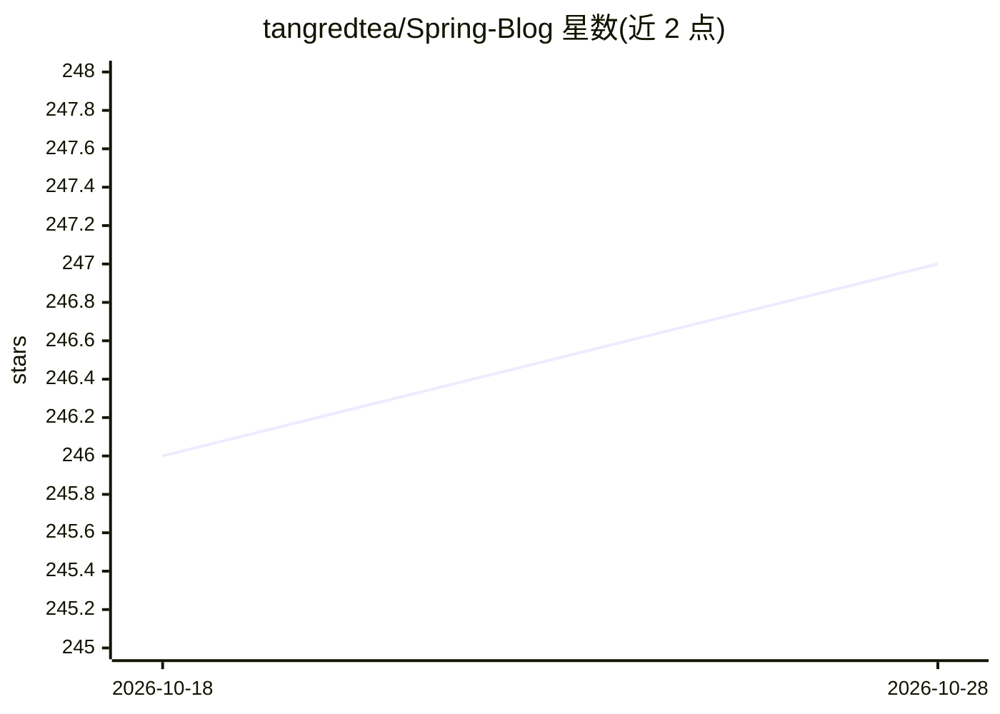

# tangredtea/Spring-Blog

⭐ 247 · Java · Apache-2.0 · 推送 2026-03-12 · [GitHub](https://github.com/tangredtea/Spring-Blog) · 个人维护 · 中文 README

**Spring Boot 个人博客系统，可选接入 AI 做摘要与标签**

基于 Spring Boot 2.7.x + MyBatis + MySQL + Redis + Thymeleaf 的个人博客系统，提供 Markdown 编辑器、草稿、分类标签、评论、留言板、后台管理仪表盘、SEO 优化、企业微信错误通知与 Docker Compose 部署。AI 功能为可选模块：通过配置 OpenAI API key 实现自动摘要、标签推荐、文章质量评分与智能搜索；未配置时系统回退到默认行为。安全方面使用 BCrypt、参数化查询与登录拦截器。

## 筛选速览

| 维度 | 判定 | 备注 |
|---|---|---|
| AI 角色 | `ai-enhanced` | 去掉 AI 部分产品仍成立 |
| 许可风险 | `permissive` | Apache-2.0 |
| 部署形态 | `self-host` | docker 或自建部署 |
| 模型依赖 | — | README 未给出锁定关系 |
| 硬件要求 | — | 无带数字的原话,不猜 |
| 安装摩擦 | `low` | 无编译、无系统依赖或容器化 |
| 成熟度 | — | 结构信号不足 |

## 能力要点

- 可选 OpenAI 集成：自动摘要、标签推荐、质量评分、智能搜索
- Redis 缓存、HikariCP 连接池、数据库索引优化
- 后台仪表盘含 AI 服务可用性监控
- 未配置 AI key 时优雅回退默认行为

## 适用场景

- 搭建带 AI 辅助写作能力的个人博客
- 学习 Spring Boot 全栈开发或用于毕设
- 通过 Docker Compose 快速部署博客站点

## 场景标签

`AI 写作` · 领域:内容生成

## 证据(README 行号)

> L8: > A personal blog system built with Spring Boot + MyBatis, featuring AI-powered content assistance, Redis caching, a
> L127: AI features are optional. To enable them, set the following in `application-dev.yml` or via environment variables:
> L137: When AI is not configured, the system gracefully falls back to default behavior (no errors).

## 星数曲线

2026-10-18 246 → 2026-10-28 247（+1）

---
*卡片 v1 · prompt 1.4 · 生成 2026-10-22 · 置信度 high · 依据 README sha `f2ea6edaba99` · [字段定义](../../DATASET.md)*
