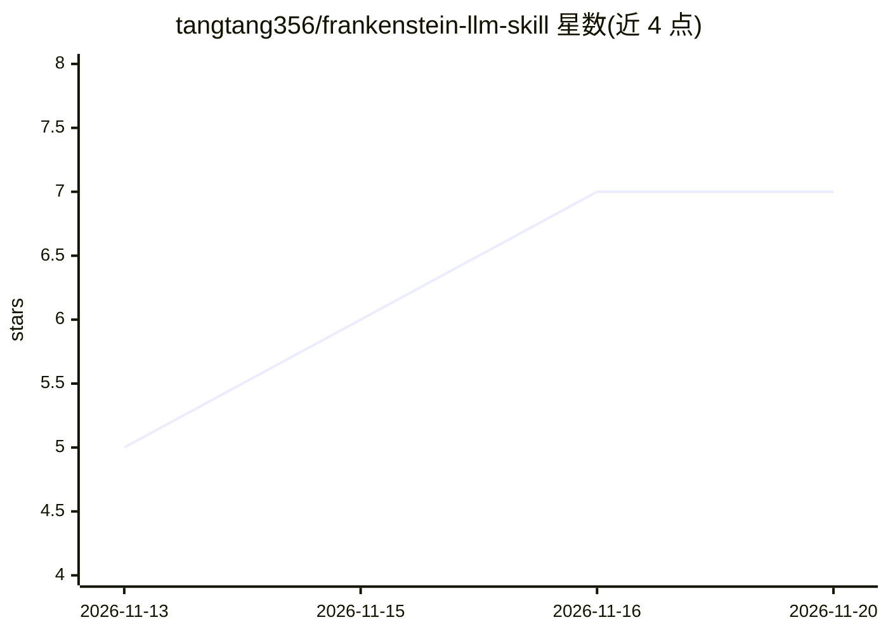

# tangtang356/frankenstein-llm-skill

⭐ 7 · MIT · 推送 2026-11-11 · [GitHub](https://github.com/tangtang356/frankenstein-llm-skill) · 个人维护 · 中文 README

**指导 AI Agent 部署并持续优化本地 LLM 的技能包**

以 Agent Skill 形式提供的指令与方法集：仓库本身不含推理引擎或模型权重，仅提供指导文件、实施方法与小型测试夹具，安装到 agent 的技能目录后由 agent 执行。工作流为：检查目标机器硬件→调研兼容方案→协商部署计划→实施配置→优化缓存、解码、传输与专家供给→用真实任务验证并记录部署笔记，支持新机器部署与既有部署的续作优化。执行指南目前为中文，英文页面介绍工作流。

## 筛选速览

| 维度 | 判定 | 备注 |
|---|---|---|
| AI 角色 | `ai-ecosystem` | LLM/agent 周边工具 |
| 许可风险 | `permissive` | MIT |
| 部署形态 | `None` |  |
| 模型依赖 | — | README 未给出锁定关系 |
| 硬件要求 | — | 无带数字的原话,不猜 |
| 安装摩擦 | `low` | 无编译、无系统依赖或容器化 |
| 成熟度 | — | 结构信号不足 |

## 能力要点

- 硬件感知的本地部署工作流：检查、调研、计划、部署、验证
- 覆盖本地与 SSH 主机、GPU/CPU 推理、多 GPU 与 expert-offload
- 支持从部署笔记与进程状态恢复既有优化项目
- 提供两个历史部署案例记录（4×V100 与双 RTX 2080 Ti）

## 适用场景

- 在一台新机器上让 agent 调研并落地本地模型部署方案
- 诊断已有部署的解码慢、响应延迟、缓存丢失等问题
- 多轮长周期优化项目中交接续作，避免重复劳动
- 将已有后端的性能机制移植到目标设备

## 场景标签

 · 领域:LLM 基础设施/部署优化

## 证据(README 行号)

> L9: Frankenstein is an Agent Skill centered on composing existing inference implementations across repositories. Combina
> L13: This repository contains instructions, implementation methods, and small test fixtures. It does not include an infe

## 星数曲线

2026-11-13 5 → 2026-11-20 7（+2）

---
*卡片 v1 · prompt 1.4 · 生成 2026-11-20 · 置信度 high · 依据 README sha `9748c792d4b6` · [字段定义](../../DATASET.md)*
