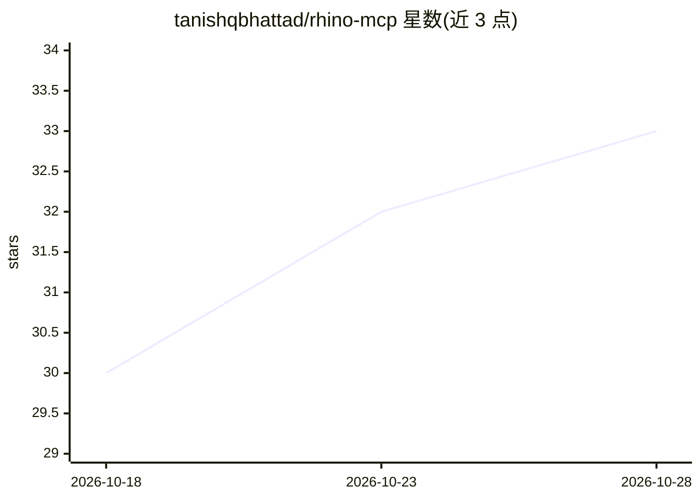

# tanishqbhattad/rhino-mcp

⭐ 33 · C# · MIT · 推送 2026-10-12 · [GitHub](https://github.com/tanishqbhattad/rhino-mcp) · 个人维护

**给建筑师的 MCP 服务器：让 AI 客户端直接控制 Rhino 8 建模**

面向 Rhino 8 / Rhinoceros 3D 的 Model Context Protocol 服务器，使 Claude、ChatGPT、Codex、Gemini 或本地 Ollama 模型能以自然语言驱动建筑建模：体量、楼板、核心筒、拱券、穹棱拱、平面剖面与面积表等 128 个工具（lean/standard/full 三档）。内置意图校验机制，在几何创建时断言 bbox/数量/水密性等后置条件，返回出错对象 ID；另有视口截图回看、DWG/PDF 导入、原子批次与回滚恢复。Windows 一键安装脚本自动配置检测到的 AI 客户端，无需 .NET SDK；要求 Windows + Rhino 8 + 一个支持 MCP 的 AI 客户端。

## 筛选速览

| 维度 | 判定 | 备注 |
|---|---|---|
| AI 角色 | `ai-ecosystem` | LLM/agent 周边工具 |
| 许可风险 | `permissive` | MIT |
| 部署形态 | `desktop` | 安装包/桌面程序 |
| 模型依赖 | local-ok | 支持本地模型 |
| 硬件要求 | — | 无带数字的原话,不猜 |
| 安装摩擦 | `medium` | 含编译或系统依赖之一 |
| 成熟度 | — | 结构信号不足 |

## 能力要点

- 128 个工具分 lean/standard/full 三档，小模型可用精简档
- 意图校验：bbox/数量/水密/悬空等后置条件在创建时即断言并返回出错对象 ID
- rab 几何库自动注入脚本，含尖拱求解、穹棱拱、玫瑰窗等建筑构件
- 原子批次、回滚与 write-ahead-log 崩溃恢复；视口截图与前后像素对比

## 适用场景

- 建筑师用自然语言在 Rhino 中生成体量、楼板、核心筒与立面开窗
- 历史建筑建模（拱券、穹棱拱、玫瑰窗）并自动校验几何意图
- 从 PDF 平面图或 DWG 导入描图后继续建模
- 用本地 Ollama 模型离线驱动 Rhino 建模

## 场景标签

 · 领域:建筑设计/3D 建模工具

## 证据(README 行号)

> L3: **A Model Context Protocol (MCP) server that gives Claude, ChatGPT, Codex, Gemini or a local Ollama model full contr
> L175: `INSTALL.bat` configures whatever it detects. Manual configuration:
> L198: ### Ollama (fully local, free)

## 星数曲线

2026-10-18 30 → 2026-10-28 33（+3）

---
*卡片 v1 · prompt 1.4 · 生成 2026-10-25 · 置信度 high · 依据 README sha `1d2b9de8ab9b` · [字段定义](../../DATASET.md)*
