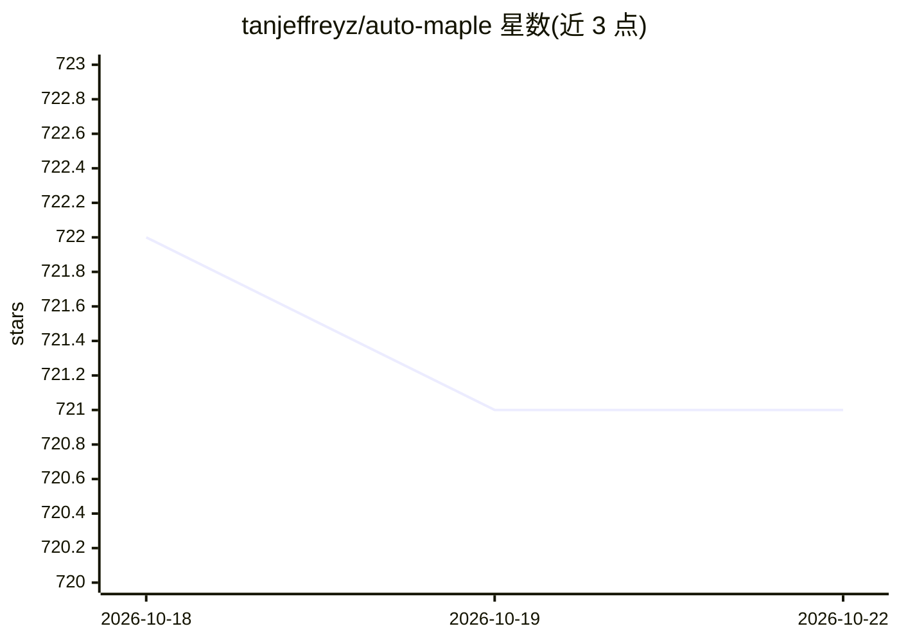

# tanjeffreyz/auto-maple

⭐ 721 · Python · 推送 2025-12-26 · [GitHub](https://github.com/tanjeffreyz/auto-maple) · 个人维护

**用 CV 与机器学习自动玩冒险岛（MapleStory）的 Python AI 程序**

面向 MapleStory 玩家的 Python 自动化程序：通过模拟按键操作角色，使用 OpenCV 模板匹配追踪小地图与玩家位置、四叉树 Layout 配合 A* 搜索计算最短路径，并以自定义训练的 TensorFlow 模型加 Canny 边缘检测自动解符文 puzzles。玩法逻辑由社区提供的两类文件驱动：各职业 command book（Python 技能类定义）与各地图 routine（CSV 指令序列），程序内置编译器解析执行。安装需 Python3、CUDA Toolkit，pip 装依赖后运行 setup.py 生成桌面快捷方式。

## 筛选速览

| 维度 | 判定 | 备注 |
|---|---|---|
| AI 角色 | `ai-native` | 本体是模型或模型工具 |
| 许可风险 | `none` | — |
| 部署形态 | `library` | 以包/库形式分发 |
| 模型依赖 | — | README 未给出锁定关系 |
| 硬件要求 | — | 无带数字的原话,不猜 |
| 安装摩擦 | `medium` | 含编译或系统依赖之一 |
| 成熟度 | — | 结构信号不足 |

## 能力要点

- OpenCV 模板匹配定位小地图并追踪玩家位置
- 四叉树 Layout + A* 搜索计算最短移动路径
- 自定义 TensorFlow 模型自动解符文（箭头 puzzles）
- 模块化 command book 与 routine CSV 驱动任意职业与地图

## 适用场景

- 让 AI 替我操作冒险岛角色刷图与执行技能循环
- 为特定职业和地图编写/使用 routine 自动完成日常任务
- 自动解游戏中的箭头符文 puzzles

## 场景标签

 · 领域:游戏/自动化

## 证据(README 行号)

> L3: Auto Maple is an intelligent Python AI that plays MapleStory, a 2D side-scrolling MMORPG, using simulated key presse
> L41: Auto Maple has the ability to automatically solve "runes", or in-game arrow key puzzles. It first uses OpenCV's col

## 星数曲线

2026-10-18 722 → 2026-10-22 721（-1）

---
*卡片 v1 · prompt 1.4 · 生成 2026-10-21 · 置信度 high · 依据 README sha `7ee998412522` · [字段定义](../../DATASET.md)*
