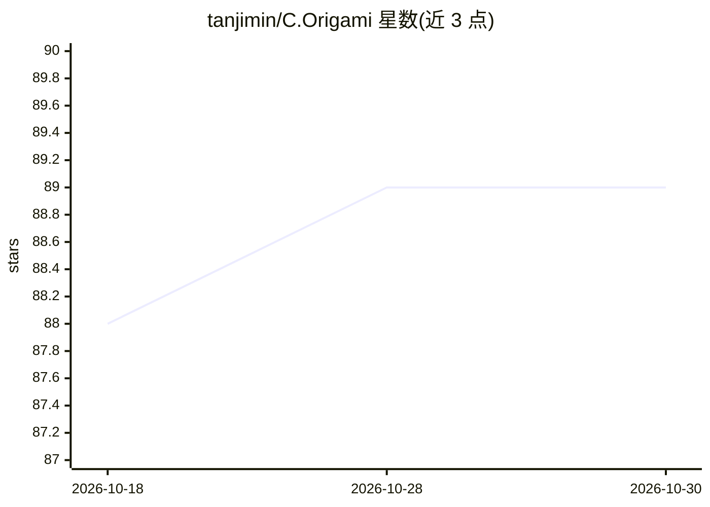

# tanjimin/C.Origami

⭐ 89 · Python · 推送 2026-03-22 · [GitHub](https://github.com/tanjimin/C.Origami) · 个人维护

**预测细胞类型特异性 3D 染色质结构的深度学习框架**

C.Origami 是发表于 Nat Biotechnol 2023 论文的官方实现，基于 Origami 架构（DNA 序列 + 细胞类型特征）的深度神经网络，可从 CTCF ChIP-seq、ATAC-seq 等输入 de novo 预测细胞类型特异性 Hi-C 染色质结构。支持三类推理任务：predict（输出 2MB 窗口图像与 numpy 矩阵）、perturbation（缺失编辑预测）、screening（全染色体滑动缺失并输出影响分数 bedgraph）。预训练模型基于人 IMR-90 细胞系，支持在人或小鼠细胞上自训模型；数据与权重托管于 Zenodo。以 pip 包（含推理/训练两种依赖集）及源码安装方式提供，另有 Colab Notebook。

## 筛选速览

| 维度 | 判定 | 备注 |
|---|---|---|
| AI 角色 | `ai-native` | 本体是模型或模型工具 |
| 许可风险 | `none` | — |
| 部署形态 | `library` | 以包/库形式分发 |
| 模型依赖 | — | README 未给出锁定关系 |
| 硬件要求 | — | 无带数字的原话,不猜 |
| 安装摩擦 | `medium` | 含编译或系统依赖之一 |
| 成熟度 | — | 结构信号不足 |

## 能力要点

- 从 DNA 序列与细胞类型特征 de novo 预测 Hi-C 染色质结构
- 缺失扰动预测与全染色体 in silico 遗传筛选（输出影响分数 bedgraph）
- 预训练模型（IMR-90）与 GM12878 add-on 数据公开于 Zenodo
- 提供 4 种评估指标实现（MSE、Insulation Score 等）与自定义细胞类型训练流程

## 适用场景

- 预测特定细胞系的 3D 染色质结构
- 模拟基因组缺失/易位等扰动对结构的影响
- 全染色体筛选高影响扰动区域以寻找 trans 作用因子
- 在自己的人或小鼠细胞数据上训练定制模型

## 场景标签

 · 领域:计算生物学/基因组学

## 证据(README 行号)

> L7: This is the official implementation of C.Origami model from Cell type-specific prediction of 3D chromatin organizati
> L63: C.Origami can perform de novo prediction of cell type-specific chromatin architecture using both DNA sequence featu
> L101: In silico genetic screening can be used to see what regions of perturbation lead to the greatest impact on the pre

## 星数曲线

2026-10-18 88 → 2026-10-30 89（+1）

---
*卡片 v1 · prompt 1.4 · 生成 2026-10-24 · 置信度 high · 依据 README sha `e613c0bf1bcf` · [字段定义](../../DATASET.md)*
