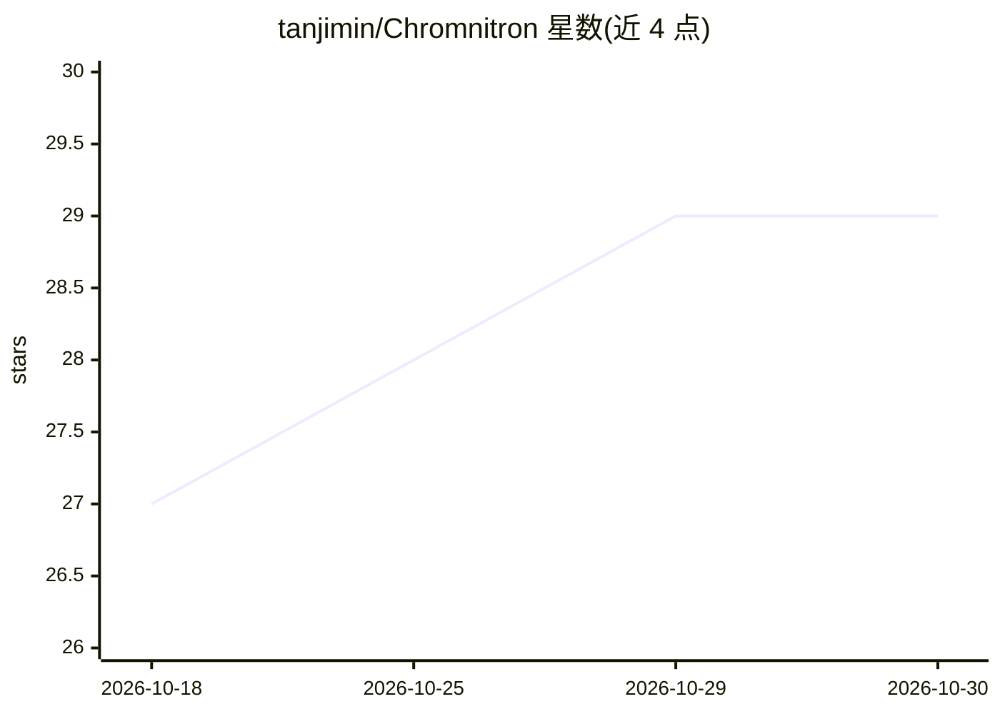

# tanjimin/Chromnitron

⭐ 29 · Python · 推送 2026-05-05 · [GitHub](https://github.com/tanjimin/Chromnitron) · 组织维护

**预测人类基因组上染色质相关蛋白结合位点的多模态模型**

包含 Chromnitron 模型与配套数据处理管线 Chrom2vec：前者预测染色质相关蛋白在人类基因组上的结合，后者将原始测序数据处理为模型可用格式。当前为早期发布，仅包含 Chromnitron 推理管线与 Chrom2vec 的 ATAC-seq 处理组件，完整版本后续发布。提供 Google Colab 交互环境、本地推理设置说明及自定义 ATAC-seq 数据分析路径，预印本发布于 bioRxiv。

## 筛选速览

| 维度 | 判定 | 备注 |
|---|---|---|
| AI 角色 | `ai-native` | 本体是模型或模型工具 |
| 许可风险 | `none` | — |
| 部署形态 | `None` |  |
| 模型依赖 | — | README 未给出锁定关系 |
| 硬件要求 | — | 无带数字的原话,不猜 |
| 安装摩擦 | `low` | 无编译、无系统依赖或容器化 |
| 成熟度 | `idea` | |

## 能力要点

- 多模态模型预测染色质相关蛋白结合
- Chrom2vec 管线处理原始测序数据（ATAC-seq 组件）
- 当前仅含推理管线，完整版待发布

## 适用场景

- 预测转录因子等染色质相关蛋白在基因组上的结合位点
- 用自己的 ATAC-seq 数据做自定义分析
- 通过 Colab 快速试用模型

## 场景标签

 · 领域:计算生物学/基因组学

## 证据(README 行号)

> L5: This repository contains the official implementation of **Chromnitron** and its associated data-processing pipeline,
> L19: * **`chromnitron/`**: This directory holds the core Chromnitron model, designed for predicting chromatin-associated

## 星数曲线

2026-10-18 27 → 2026-10-30 29（+2）

---
*卡片 v1 · prompt 1.4 · 生成 2026-10-26 · 置信度 mid · 依据 README sha `6ef7beea5c6d` · [字段定义](../../DATASET.md)*
