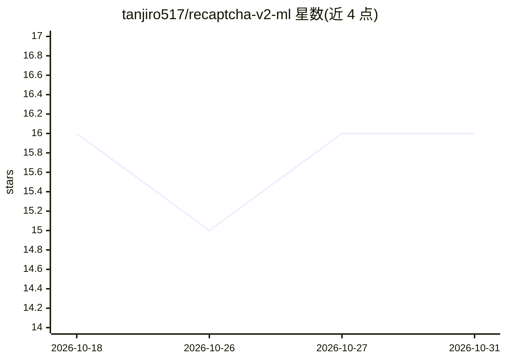

# tanjiro517/recaptcha-v2-ml

⭐ 16 · Jupyter Notebook · 推送 2025-11-11 · [GitHub](https://github.com/tanjiro517/recaptcha-v2-ml) · [官网](https://t.me/rex_update) · 个人维护

**用 YOLO 模型分析 reCAPTCHA v2 图像挑战的教学演示项目**

演示如何用 YOLO 目标检测模型分析与预测 reCAPTCHA v2 图像挑战中的对象：solver.py 通过 Selenium 启动 Chrome 访问 reCAPTCHA 演示页面，用训练好的 YOLO 模型检测图像并展示预测过程。提供 YOLO_train.ipynb 供在标注的 CAPTCHA 图像上自行训练模型。README 反复声明仅供研究与教学演示、不用于绕过真实安全系统，并通过 Telegram 提供所谓高级版本的联系方式。需 Python 3.10+、Chrome 与 ChromeDriver，建议 GPU 版 PyTorch。

## 筛选速览

| 维度 | 判定 | 备注 |
|---|---|---|
| AI 角色 | `ai-native` | 本体是模型或模型工具 |
| 许可风险 | `none` | — |
| 部署形态 | `library` | 以包/库形式分发 |
| 模型依赖 | — | README 未给出锁定关系 |
| 硬件要求 | — | 无带数字的原话,不猜 |
| 安装摩擦 | `low` | 无编译、无系统依赖或容器化 |
| 成熟度 | — | 结构信号不足 |

## 能力要点

- Selenium + YOLO 自动化分析 reCAPTCHA 演示页面
- 提供 Jupyter Notebook 在标注图像上训练 YOLO 模型
- 可切换 HEADLESS 模式观察浏览器操作过程

## 适用场景

- 学习 YOLO 如何检测小型图像模式与边界框
- 研究 CAPTCHA 可用性与可访问性
- 实验图像分类数据集与目标检测流程

## 场景标签

`目标检测` `教程课程` · 领域:学习与行业

## 证据(README 行号)

> L7: This project demonstrates how a YOLO (You Only Look Once) model can be used to analyze and predict objects in reCAPT
> L88:  * Detect images using YOLO

## 星数曲线

2026-10-18 16 → 2026-10-31 16（+0）

---
*卡片 v1 · prompt 1.4 · 生成 2026-10-30 · 置信度 mid · 依据 README sha `4cf785aa98bd` · [字段定义](../../DATASET.md)*
