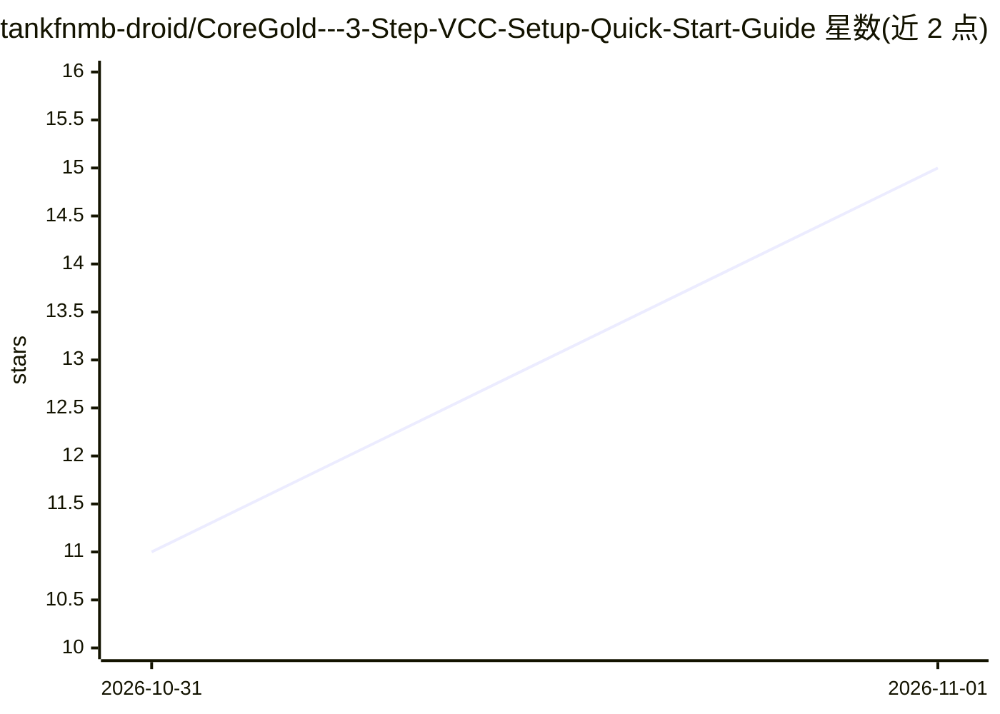

# tankfnmb-droid/CoreGold---3-Step-VCC-Setup-Quick-Start-Guide

⭐ 15 · 推送 2026-10-30 · [GitHub](https://github.com/tankfnmb-droid/CoreGold---3-Step-VCC-Setup-Quick-Start-Guide) · [官网](https://app.coregold.io/signup?invite_code=ADvlj9b) · 个人维护 · 中文 README

**CoreGold 海外虚拟卡开卡充值的三步图文指南**

面向无经验消费者的 CoreGold 虚拟信用卡（Visa/Mastercard）使用教程：介绍邮箱注册、用 USDT 从交易所或钱包充值余额、在后台一键生成带卡号/有效期/CVV 及英文账单地址的虚拟卡，再到海外平台结账付款的操作流程；另说明留足额度应对验资扣款、账单地址照抄系统提供内容、闲置卡注销可退余额等注意事项。内容为第三方托管在 GitHub 的推广性指南，非软件项目，无安装或代码运行环节；通篇未涉及 AI 技术。

## 筛选速览

| 维度 | 判定 | 备注 |
|---|---|---|
| AI 角色 | `ai-knowledge` | 知识聚合/清单类 |
| 许可风险 | `none` | — |
| 部署形态 | `None` |  |
| 模型依赖 | — | README 未给出锁定关系 |
| 硬件要求 | — | 无带数字的原话,不猜 |
| 安装摩擦 | `low` | 无编译、无系统依赖或容器化 |
| 成熟度 | — | 结构信号不足 |

## 能力要点

- 三步流程：注册充值 USDT → 一键生成虚拟卡 → 海外平台结账
- 生成内容含 16 位卡号、有效期、CVV 与配套英文账单地址
- 说明验资扣款、账单地址填写与注销退余额等使用注意事项

## 适用场景

- 想用国内资金支付海外软件订阅或海淘的消费者按步骤开卡
- 了解 USDT 充值虚拟卡与注销退款的基本流程

## 场景标签

`教程课程` · 领域:学习与行业

## 证据(README 行号)

> L2: 🚀 CoreGold 纯小白极速上手指南（3 步搞定海外支付）
> L5: > **一句话大白话**：国内银行卡付不了国外软件，找代付又贵又不安全。用 **CoreGold** 自己生成一张海外 Visa / Mastercard 虚拟卡，手机/电脑操作 3 分钟搞定，充多少用多少，安全不踩坑。

## 星数曲线

2026-10-31 11 → 2026-11-01 15（+4）

---
*卡片 v1 · prompt 1.4 · 生成 2026-10-31 · 置信度 mid · 依据 README sha `cd0d41c10349` · [字段定义](../../DATASET.md)*
