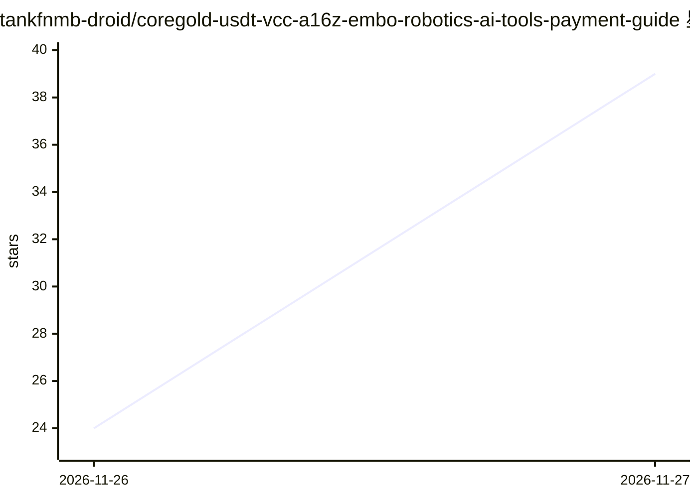

# tankfnmb-droid/coregold-usdt-vcc-a16z-embo-robotics-ai-tools-payment-guide

⭐ 39 · 推送 2026-11-24 · [GitHub](https://github.com/tankfnmb-droid/coregold-usdt-vcc-a16z-embo-robotics-ai-tools-payment-guide) · [官网](https://app.coregold.io/signup?invite_code=ADvlj9b) · 组织维护 · 中文 README

**开发者海外订阅跨境支付教程：用 CoreGold 虚拟卡付款**

以 Embo 融资新闻为引子的支付操作指南，面向需要订阅海外开发工具（数据集、仿真软件、云套件）的用户，讲解 CoreGold USDT 虚拟卡的开卡流程：注册、TRC20 充值、选择卡段与账单信息、绑定 Apple Pay/Google Pay；并提供试用专卡防扣费、AVS 地址对齐等 4 条操作要点。README 含邀请链接，内容以该商业服务操作为主。

## 筛选速览

| 维度 | 判定 | 备注 |
|---|---|---|
| AI 角色 | `ai-knowledge` | 知识聚合/清单类 |
| 许可风险 | `none` | — |
| 部署形态 | `None` |  |
| 模型依赖 | — | README 未给出锁定关系 |
| 硬件要求 | — | 无带数字的原话,不猜 |
| 安装摩擦 | `low` | 无编译、无系统依赖或容器化 |
| 成熟度 | — | 结构信号不足 |

## 能力要点

- USDT（TRC20）充值开卡的完整步骤教程
- 支持绑定 Apple Pay 与 Google Pay（L15-16）
- 试用专卡冻结与 AVS 账单地址对齐操作要点
- 提供个人计划与团队计划两类开卡选项

## 适用场景

- 订阅海外开发套件时需要美区支付卡
- 给试用期订阅开临时卡避免到期扣费
- 用 USDT 充值开立美国发行虚拟卡

## 场景标签

`教程课程` · 领域:学习与行业

## 证据(README 行号)

> L2: 11 月 23 日 a16z 领投机器人基础模型公司 Embo 1.1 亿美元种子轮，具身智能与空间仿真开发全线提速——聊聊开发者在拉取海外数据集、订阅仿真软件和云开发套件时，如何用 CoreGold 虚拟卡 摆脱跨境支付障碍。
> L22: ### 🧭 CoreGold 极简开卡与绑定教程（一看就会）
> L25: 访问 **CoreGold 官方平台**：https://app.coregold.io/signup?invite_code=ADvlj9b，使用常用邮箱注册并登录进入用户后台。

## 星数曲线

2026-11-26 24 → 2026-11-27 39（+15）

---
*卡片 v1 · prompt 1.4 · 生成 2026-11-26 · 置信度 mid · 依据 README sha `8cd6edad8e03` · [字段定义](../../DATASET.md)*
