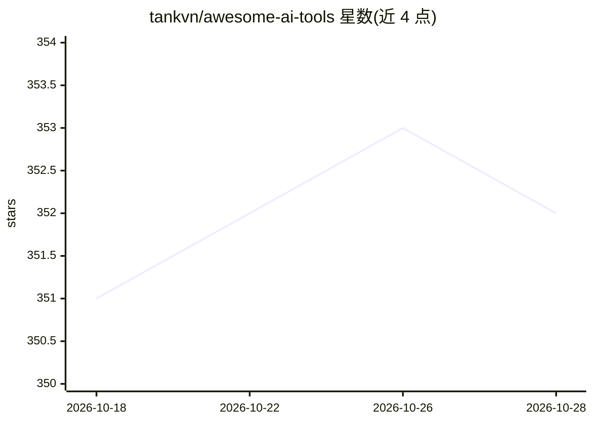

# tankvn/awesome-ai-tools

⭐ 352 · 推送 2026-09-12 · [GitHub](https://github.com/tankvn/awesome-ai-tools) · 个人维护

**收录 7766 个 AI 工具的策展清单**

按分类组织的 AI 工具导航清单，自称收录 7766 个条目，覆盖生产力、文本生成、图像、视频、音频、商业、代码、AI 检测等数十个大类及细分小类。每个条目为工具名称、一句话简介与定价标签（Free/Freemium/Paid 等），以 README 目录形式提供，供用户浏览与查找 AI 工具，无需安装，不含代码。

## 筛选速览

| 维度 | 判定 | 备注 |
|---|---|---|
| AI 角色 | `ai-knowledge` | 知识聚合/清单类 |
| 许可风险 | `none` | — |
| 部署形态 | `None` |  |
| 模型依赖 | — | README 未给出锁定关系 |
| 硬件要求 | — | 无带数字的原话,不猜 |
| 安装摩擦 | `low` | 无编译、无系统依赖或容器化 |
| 成熟度 | — | 结构信号不足 |

## 能力要点

- 7766 个 AI 工具条目
- 数十个大类、上百个细分小类的目录结构
- 条目附定价标签（Free/Freemium/Paid 等）

## 适用场景

- 按分类查找特定场景的 AI 工具
- 了解 AI 工具在各领域的覆盖情况

## 场景标签

`精选清单` · 领域:学习与行业

## 证据(README 行号)

> L1: # Awesome AI Tools
> L2: A curated list of awesome AI tools
> L4: - Awesome AI Tools

## 星数曲线

2026-10-18 351 → 2026-10-28 352（+1）

---
*卡片 v1 · prompt 1.4 · 生成 2026-10-21 · 置信度 high · 依据 README sha `a585177b0696` · [字段定义](../../DATASET.md)*
