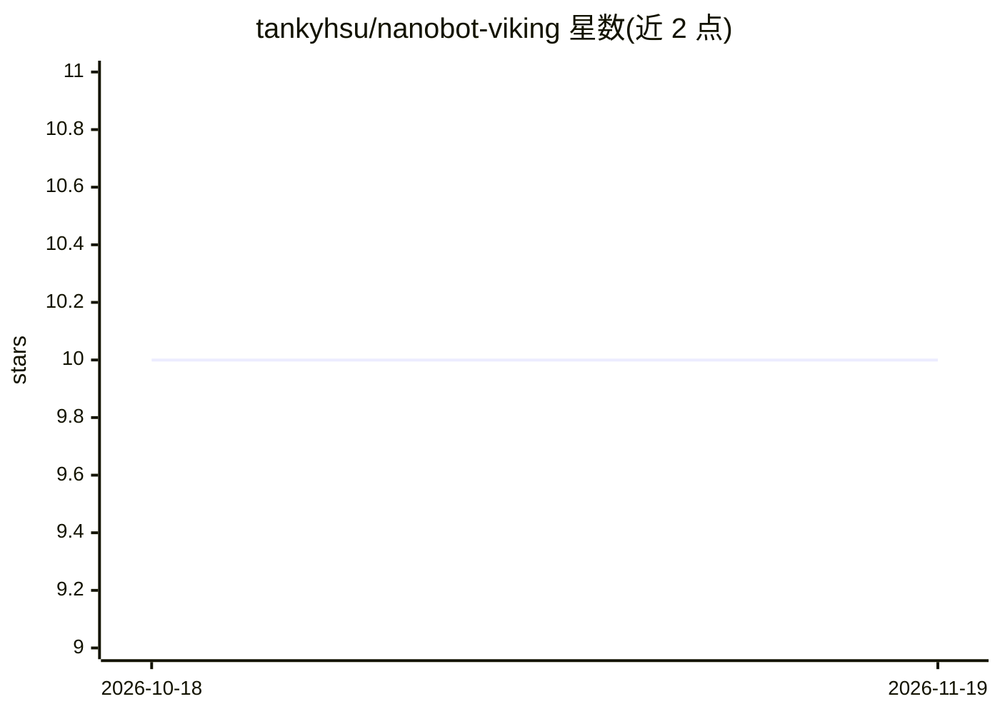

# tankyhsu/nanobot-viking

⭐ 10 · Python · 推送 2026-04-05 · [GitHub](https://github.com/tankyhsu/nanobot-viking) · 个人维护 · 中文 README

**为 nanobot 接入 OpenViking 知识库的 RAG 集成服务**

nanobot 的 OpenViking 知识库集成插件：在用户消息送达 LLM 前检索知识库上下文并注入（RAG 增强），提供语义搜索与深度搜索 HTTP 端点、文件入库（Markdown/PDF/图像，自动分块、嵌入、索引）、viking:// 虚拟文件系统浏览 API 与 CLI 工具。因 OpenViking 的 SyncOpenViking 非线程安全，全部操作经单一工作线程队列串行化，并以 async 包装桥接 FastAPI。初始化失败时服务正常运行、仅禁用 Viking 功能。

## 筛选速览

| 维度 | 判定 | 备注 |
|---|---|---|
| AI 角色 | `ai-ecosystem` | LLM/agent 周边工具 |
| 许可风险 | `none` | — |
| 部署形态 | `library` | 以包/库形式分发 |
| 模型依赖 | — | README 未给出锁定关系 |
| 硬件要求 | — | 无带数字的原话,不猜 |
| 安装摩擦 | `low` | 无编译、无系统依赖或容器化 |
| 成熟度 | — | 结构信号不足 |

## 能力要点

- RAG 上下文增强：检索结果注入用户消息后再送 LLM
- 语义搜索/深度搜索 HTTP API 与 viking CLI 工具
- 文件自动分块、嵌入、索引；PDF/图像经 DeepSeek-OCR 提取文本
- 单工作线程串行化绕过 SyncOpenViking 线程安全问题

## 适用场景

- 给 nanobot 部署增加知识库问答与 RAG 上下文
- 通过 API/CLI 管理并语义检索个人文档知识库
- 在树莓派等设备上搭建本地知识检索服务

## 场景标签

`RAG` `语义搜索` · 领域:知识与检索

## 证据(README 行号)

> L5: OpenViking knowledge base integration for nanobot. Adds semantic search, RAG context augmentation, and knowledge man
> L15: - **RAG Augmentation** — Automatically retrieves relevant knowledge base context and injects it into user messages 
> L33: OpenViking's `SyncOpenViking` is **not thread-safe** — concurrent access from multiple threads causes hangs. All op

## 星数曲线

2026-10-18 10 → 2026-11-19 10（+0）

---
*卡片 v1 · prompt 1.4 · 生成 2026-11-19 · 置信度 high · 依据 README sha `163bafb432bc` · [字段定义](../../DATASET.md)*
