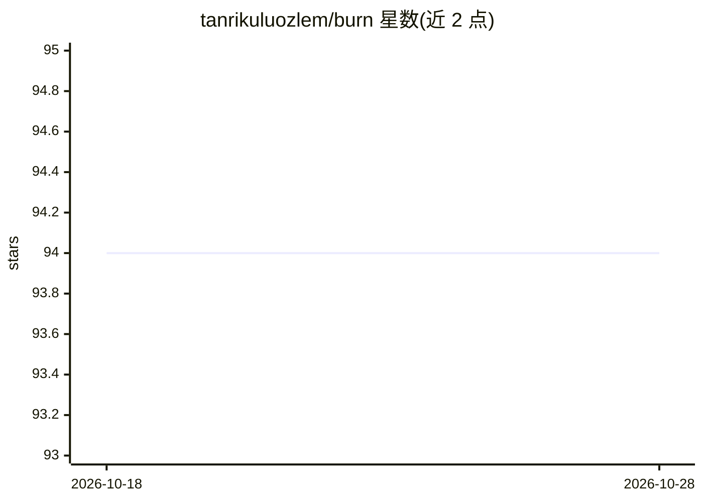

# tanrikuluozlem/burn

⭐ 94 · Go · Apache-2.0 · 推送 2026-10-27 · [GitHub](https://github.com/tanrikuluozlem/burn) · 个人维护

**Kubernetes 成本分析与账单核对的 CLI 工具**

Go 编写的 Kubernetes 成本工具：读取集群 API 与 Prometheus 用量数据，结合 AWS/Azure 定价 API 与内置定价表，计算计算、存储、负载均衡与 GPU 成本，检测孤儿资源、SP/RI/Spot 覆盖与右移机会；可将估算成本与 AWS CUR / Azure Cost Management 实际账单逐节点核对。AI 为可选功能：自然语言问答与 AI 建议需 ANTHROPIC_API_KEY，另提供 Slack 斜杠命令与 MCP server（analyze/spot_readiness/reconcile 三工具）。支持 EKS/AKS/GKE 与本地集群，通过 brew、Helm 或源码安装。

## 筛选速览

| 维度 | 判定 | 备注 |
|---|---|---|
| AI 角色 | `ai-enhanced` | 去掉 AI 部分产品仍成立 |
| 许可风险 | `permissive` | Apache-2.0 |
| 部署形态 | `library` | 以包/库形式分发 |
| 模型依赖 | locked-api |  |
| 硬件要求 | — | 无带数字的原话,不猜 |
| 安装摩擦 | `low` | 无编译、无系统依赖或容器化 |
| 成熟度 | — | 结构信号不足 |

## 能力要点

- 估算成本与 AWS CUR / Azure 实际账单逐节点核对
- 孤儿磁盘与负载均衡检测、SP/RI/Spot 覆盖缺口分析
- Slack 斜杠命令与 MCP server（Claude Code / Cursor 可接入）
- 本地与 GPU 集群可自定义 CPU/RAM/GPU/存储单价

## 适用场景

- 查看 Kubernetes 集群里哪些节点和命名空间在花钱
- 核对成本工具估算值与云厂商实际账单的差异
- 通过 Slack 或 AI agent 问答方式获取成本报告与优化建议

## 场景标签

 · 领域:云成本管理/FinOps

## 证据(README 行号)

> L8: Your Kubernetes cluster is burning money. Find out where.
> L24: - **AI-powered**: Ask questions in plain English, get recommendations with investigation commands.
> L29: - **MCP server**: Use burn from Claude Code, Cursor, or any MCP-compatible AI agent. Ask questions, get cost data.

## 星数曲线

2026-10-18 94 → 2026-10-28 94（+0）

---
*卡片 v1 · prompt 1.4 · 生成 2026-10-23 · 置信度 high · 依据 README sha `c95bcc75aac2` · [字段定义](../../DATASET.md)*
