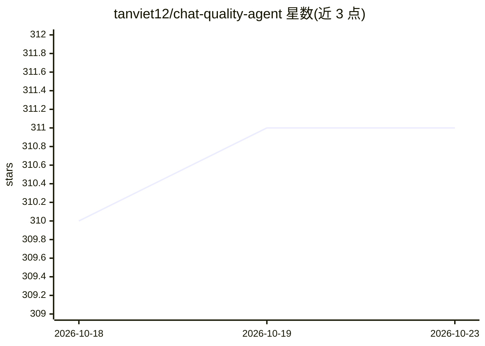

# tanviet12/chat-quality-agent

⭐ 311 · Go · MIT · 推送 2026-09-25 · [GitHub](https://github.com/tanviet12/chat-quality-agent) · [官网](https://tanviet12.github.io/chat-quality-agent/) · 个人维护

**用 AI 评估客服聊天质量的系统：同步 Zalo/FB 消息并打分告警**

面向企业客服质量管理的 Web 系统：自动同步 Zalo OA、Facebook Messenger 与 Pancake 的聊天消息，调用 AI（Claude、Gemini、ChatGPT、Grok）对客服对话进行达标判定、0-100 打分与详细点评，并按自定义主题分类；检测到问题可通过 Telegram/Email 发送告警。支持多租户与 Owner/Admin/Member 分级权限、批量 AI 调用模式、带图表的 Dashboard，以及供 Claude Web/Desktop 使用的 MCP 集成。通过安装脚本或 Docker Compose 从源码构建部署，后端 Go、前端 Vue 3、数据库 MySQL 8.0。

## 筛选速览

| 维度 | 判定 | 备注 |
|---|---|---|
| AI 角色 | `ai-native` | 本体是模型或模型工具 |
| 许可风险 | `permissive` | MIT |
| 部署形态 | `self-host` | docker 或自建部署 |
| 模型依赖 | locked-api |  |
| 硬件要求 | — | 无带数字的原话,不猜 |
| 安装摩擦 | `low` | 无编译、无系统依赖或容器化 |
| 成熟度 | — | 结构信号不足 |

## 能力要点

- 同步 Zalo OA / Facebook Messenger / Pancake 消息并用 AI 打分评估（达标判定、0-100 分、详细点评）
- 按自定义主题分类聊天并经 Telegram/Email 自动告警
- 多租户与 Owner/Admin/Member 分级权限
- 供 Claude Web/Desktop 使用的 MCP 集成

## 适用场景

- 客服团队需要自动评估对话质量并接收不合格告警
- 多公司/多团队共用一套客服质检系统
- 按投诉、咨询等主题对客服聊天做分类统计

## 场景标签

 · 领域:企业客服/质量管理

## 证据(README 行号)

> L6: Hệ thống phân tích chất lượng chăm sóc khách hàng bằng AI. Tự động đồng bộ tin nhắn từ Zalo OA, Facebook Messenger, 
> L15: - **Đánh giá chất lượng CSKH** bằng AI (Claude, Gemini, ChatGPT hoặc Grok) — Đạt/Không đạt, điểm 0-100, nhận xét ch

## 星数曲线

2026-10-18 310 → 2026-10-23 311（+1）

---
*卡片 v1 · prompt 1.4 · 生成 2026-10-21 · 置信度 high · 依据 README sha `dc51a602633a` · [字段定义](../../DATASET.md)*
