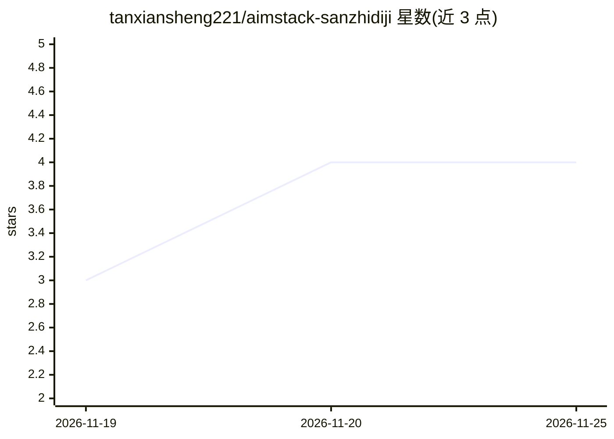

# tanxiansheng221/aimstack-sanzhidiji

⭐ 4 · Python · AGPL-3.0 · 推送 2026-11-19 · [GitHub](https://github.com/tanxiansheng221/aimstack-sanzhidiji) · 个人维护 · 中文 README

**自建本地 AI 全栈：三元 C 推理引擎+知识库+训练流水线**

以构建日志为核心的开源仓库：纯 C、零第三方依赖的三元推理引擎、插件总线、带质量门控的多引擎爬虫、FTS 知识库与无框架训练流水线，附 117 章研究日志与负结果档案。整个链路本地运行、无云端中转，权重从本地磁盘加载，仅可选 web.search 插件联网。开发机为 2018 年双核 8GB 笔记本；Windows 优先，Linux 可编译但渲染级联需 Chromium。BitNet 权重为微软所有，仓库仅提供转换层。

## 筛选速览

| 维度 | 判定 | 备注 |
|---|---|---|
| AI 角色 | `ai-native` | 本体是模型或模型工具 |
| 许可风险 | `viral` | AGPL-3.0 |
| 部署形态 | `None` |  |
| 模型依赖 | — | README 未给出锁定关系 |
| 硬件要求 | — | 无带数字的原话,不猜 |
| 安装摩擦 | `medium` | 含编译或系统依赖之一 |
| 成熟度 | — | 结构信号不足 |

## 能力要点

- 纯 C/纯 stdlib 实现的三元推理引擎，零第三方运行时
- 本地 FTS 知识库 + 插件总线，路由由确定性代码决定
- 完整训练流水线与 E6 负结果档案一并开源
- 117 章第一人称研究日志（CC-BY-NC 4.0）

## 适用场景

- 在低配 CPU 机器上本地运行三元模型推理与知识库问答
- 研究无框架的自建训练流水线与实验记录
- 复现从爬取-入库-检索-回答的完整本地链路

## 场景标签

`网页抓取` `RAG` `推理引擎` `模型训练` · 领域:效率与自动化

## 证据(README 行号)

> L3: > A build log first, runnable proof second. 117 chapters written as it happened, and a fully self-built local AI sta
> L5: No frameworks, no PyTorch dependency (used only for reconciliation during development, zero external runtime in the 

## 星数曲线

2026-11-19 3 → 2026-11-25 4（+1）

---
*卡片 v1 · prompt 1.4 · 生成 2026-11-21 · 置信度 high · 依据 README sha `004892239e67` · [字段定义](../../DATASET.md)*
