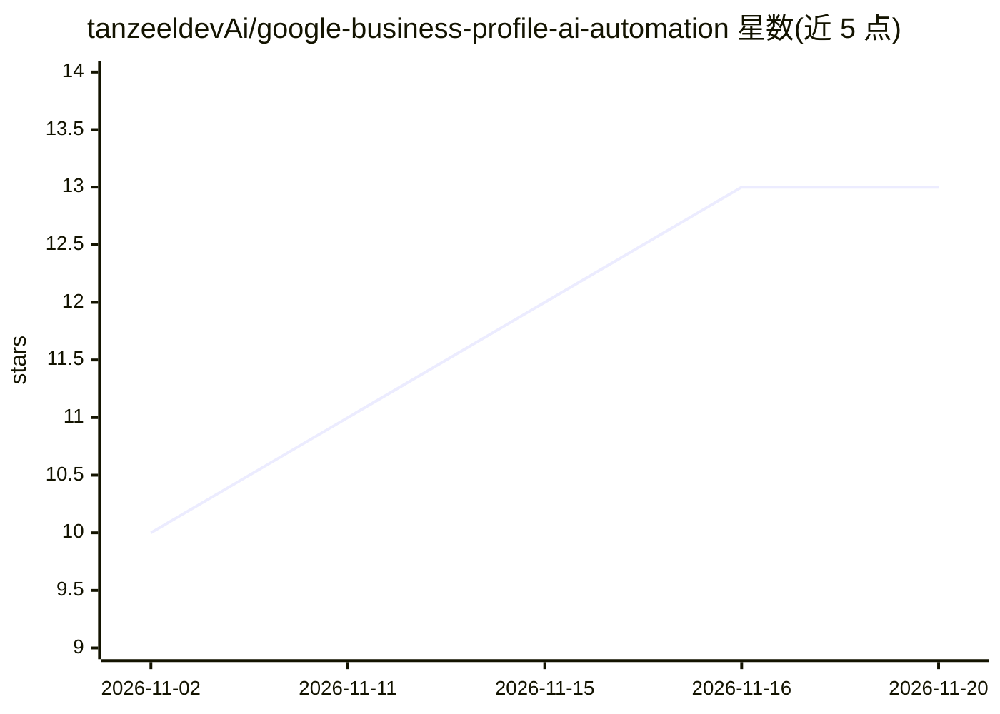

# tanzeeldevAi/google-business-profile-ai-automation

⭐ 13 · Python · MIT · 推送 2026-11-10 · [GitHub](https://github.com/tanzeeldevAi/google-business-profile-ai-automation) · 个人维护

**面向本地商家的 Google Business Profile 审计与自动运营工具**

读取商家 Google Business Profile 与其官网，按 57 条本地 SEO 规则打分，输出含'为何重要/如何处理'的自包含 HTML 报告；随后通过 API 自动改写描述、设置节假日营业时间、回复评论、按服务页撰写并发布 Google Post，并以指纹方式监控 profile 变化。所有写操作默认 dry run，需 --apply 才生效；低星评论默认留人工处理；文案只允许引用 profile 与 config.yaml facts 中的既有事实。需 Google Business Profile API 访问审批，配套本地 React+FastAPI Web 界面与终端 dashboard。

## 筛选速览

| 维度 | 判定 | 备注 |
|---|---|---|
| AI 角色 | `ai-enhanced` | 去掉 AI 部分产品仍成立 |
| 许可风险 | `permissive` | MIT |
| 部署形态 | `desktop` | 安装包/桌面程序 |
| 模型依赖 | locked-api |  |
| 硬件要求 | — | 无带数字的原话,不猜 |
| 安装摩擦 | `low` | 无编译、无系统依赖或容器化 |
| 成熟度 | — | 结构信号不足 |

## 能力要点

- 57 条规则跨 14 个领域审计，无法读取的分区报告为 not checked 而非失败
- 写操作默认 dry run，低星评论默认留人工审核
- 682 项离线测试，无需 Google 账号与网络
- 事实约束的文案生成：只引用 profile 与 config.yaml 的 facts

## 适用场景

- 给本地商家做 SEO 体检并交付 HTML 报告
- 自动回复门店的全部未答评论
- 按服务页每周自动发布 Google Post 并配图
- 监控 Google 侧对 profile 的后台改动并告警

## 场景标签

`AI 写作` `工作流自动化` · 领域:效率与自动化

## 证据(README 行号)

> L3: **Scores a Google Business Profile against 57 local SEO rules, writes a client-ready report,
> L72: |`run.py fix`|Rewrites the description; sets holiday hours; **turns the search terms the profile ignores into named
> L92: - **A Claude subscription** with the Claude Code CLI

## 星数曲线

2026-11-02 10 → 2026-11-20 13（+3）

---
*卡片 v1 · prompt 1.4 · 生成 2026-11-18 · 置信度 high · 依据 README sha `57db5cd407e0` · [字段定义](../../DATASET.md)*
