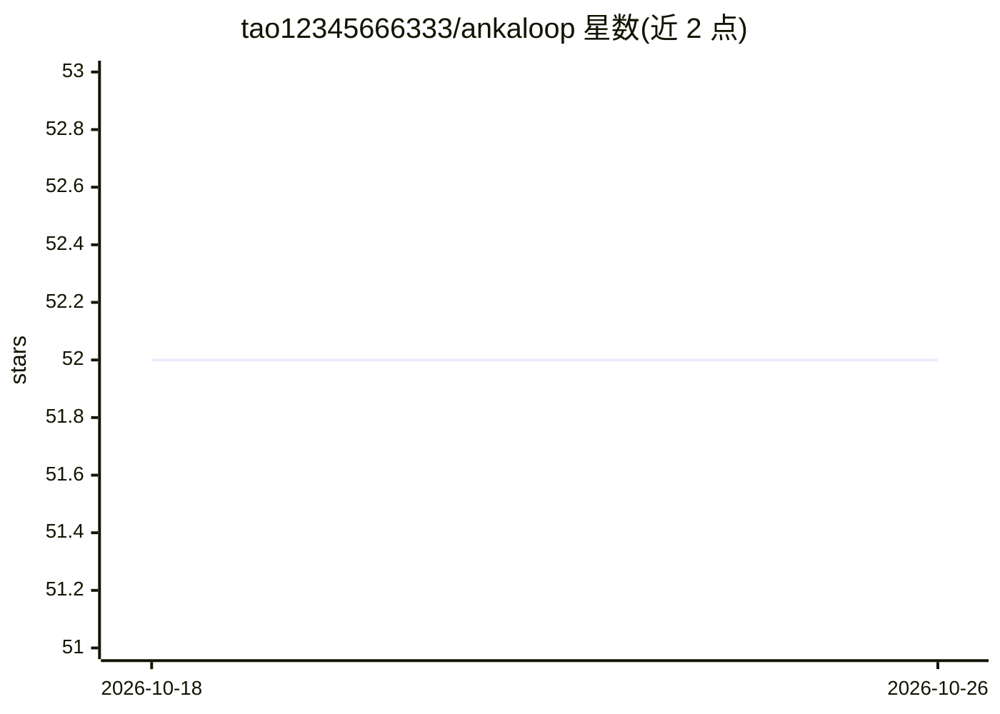

# tao12345666333/ankaloop

⭐ 52 · Python · Apache-2.0 · 推送 2026-10-25 · [GitHub](https://github.com/tao12345666333/ankaloop) · [官网](https://github.com/tao12345666333/ankaloop#why-ankaloop) · 个人维护

**面向开发者的开箱即用编码 agent 运行时**

单一 Python 包提供的编码 agent 运行时：内置文件读写/搜索、补丁、shell 执行等工具循环，持久化会话与长期记忆，多 agent 委派（coder/explorer/planner 等角色），支持技能、slash 命令、hooks、MCP 集成与 OpenTelemetry 追踪。同一运行时可从 CLI、FastAPI HTTP/WebSocket 服务器和 Telegram 访问。可连接 OpenAI、Anthropic、GMI 或任意 OpenAI 兼容端点，需 Python 3.11+。项目声明处于活跃开发中，README 提及 pre-rebrand 旧路径兼容。

## 筛选速览

| 维度 | 判定 | 备注 |
|---|---|---|
| AI 角色 | `ai-ecosystem` | LLM/agent 周边工具 |
| 许可风险 | `permissive` | Apache-2.0 |
| 部署形态 | `self-host` | docker 或自建部署 |
| 模型依赖 | — | README 未给出锁定关系 |
| 硬件要求 | — | 无带数字的原话,不猜 |
| 安装摩擦 | `low` | 无编译、无系统依赖或容器化 |
| 成熟度 | — | 结构信号不足 |

## 能力要点

- 内置 coder/explorer/planner/focused_coder 多 agent 委派
- CLI、HTTP/WebSocket 服务器与 Telegram 三种界面共用同一运行时
- MCP（stdio/HTTP/SSE）、技能、hooks、slash 命令扩展机制
- 持久化会话、长期记忆与 OpenTelemetry 追踪

## 适用场景

- 在终端里直接用 AI agent 读改和执行代码
- 自托管一个可通过 HTTP/WebSocket 或 Telegram 访问的编码 agent
- 用子 agent 委派探索、规划与受限实现任务

## 场景标签

`编码 Agent` `多智能体` `Agent 记忆` · 领域:Agent 开发

## 证据(README 行号)

> L18: AnkaLoop is for developers who want a useful coding agent now—not another framework to assemble.
> L19: It combines a capable tool loop, persistent context, multi-agent delegation, skills, memory, MCP,

## 星数曲线

2026-10-18 52 → 2026-10-26 52（+0）

---
*卡片 v1 · prompt 1.4 · 生成 2026-10-24 · 置信度 high · 依据 README sha `e2b65718f268` · [字段定义](../../DATASET.md)*
